# DxMed — offline CDR mediation platform

[](go.mod)
[](ui/package.json)
[](internal/store/migrations)
[](#tests)
[](LICENSE)

DxMed collects CDR files from network elements (MSC/MSS, SGSN/PGW/SMF, …), decodes them, validates and
filters every record, merges partial records, removes duplicates and writes the results to output
directories for billing, roaming and other downstream systems.

- **Exactly once.** A file's outputs, statistics, dedupe keys and sequences are committed in one database
  transaction; downstream systems never see a half-written file.
- **Every file balances.** `in = out + err + drop + held + dup`, shown per file and per day.
- **Per-record error isolation.** A bad record goes to the error route with a reason code; the file carries on.
- **Versioned configuration.** Every change is a new version; publishing creates an immutable release,
  gated by Template Lab regression cases. Rollback is activating an older release.
- **Scale out.** Run more engines on the same database; files are leased with `SKIP LOCKED` and one engine
  at a time is the scheduler.

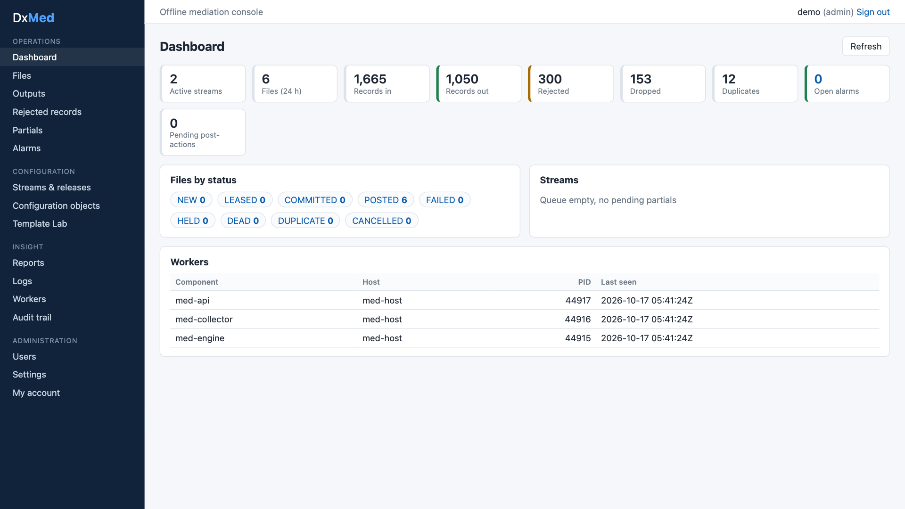

## Architecture

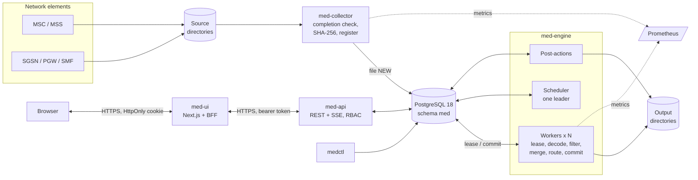

| Component | Language | Role |
|---|---|---|
| `med-collector` | Go | Watches source directories, waits until a file is complete, registers it |
| `med-engine` | Go | Leases files and runs the pipeline; scheduler, post-actions and crash recovery |
| `med-api` | Go | REST API: configuration, releases, Template Lab, operations, reports, logs, users, audit |
| `med-ui` | Next.js 16 / React 19 | Web console; its server is a backend-for-frontend holding the session |
| `medctl` | Go | CLI: migrate, bootstrap, seed, publish, user, gen (sample files), partitions, status |

## Processing pipeline

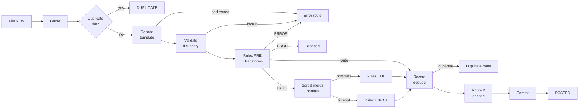

Decoders cover ASN.1 BER templates (MSC, PGW), binary blocks, CSV, fixed-width, tagged, JSON and XML.
Writers produce CSV, fixed-width, lines, JSON lines, XML and BER. Rules have two passes (a general block, then the block for the record's call
type), and each rule can apply a transform group and lookups (`set`, `map`, longest-`prefix`).

### Exactly-once commit

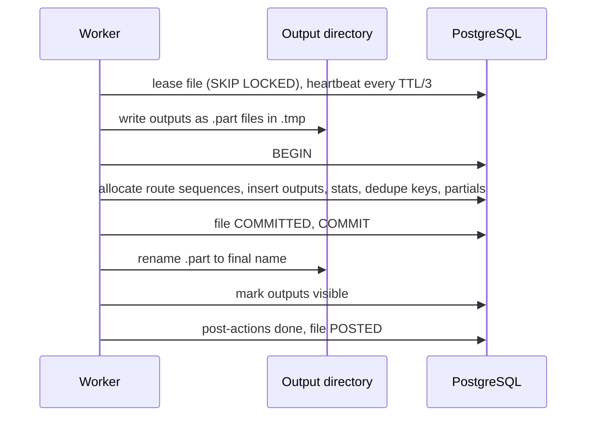

If the engine crashes before `COMMIT`, the lease expires and the file is processed again from scratch; the
`.part` files are discarded. After `COMMIT`, recovery finishes the renames, so nothing is duplicated or lost.

### File lifecycle

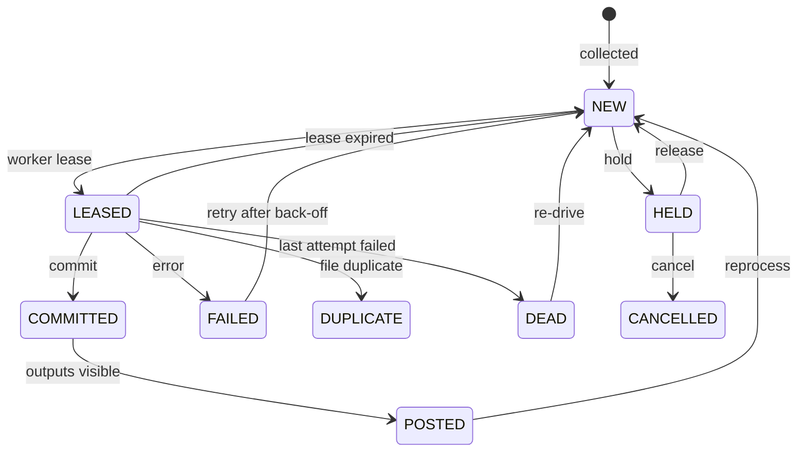

## Configuration model

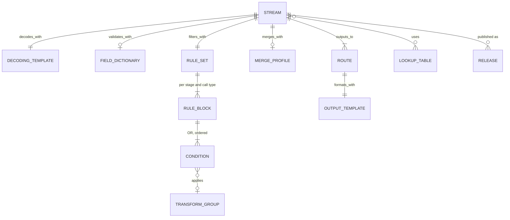

### Publishing a release

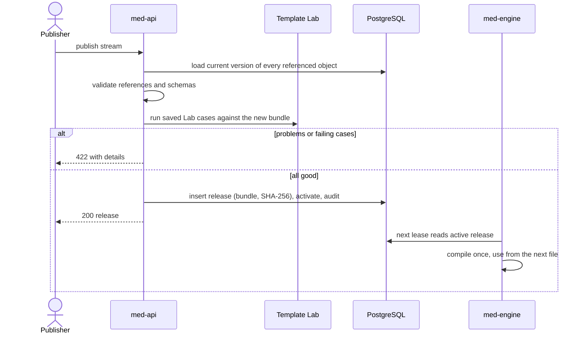

## Console

| | |
|---|---|
| 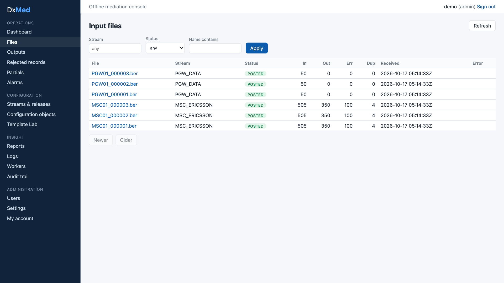 | 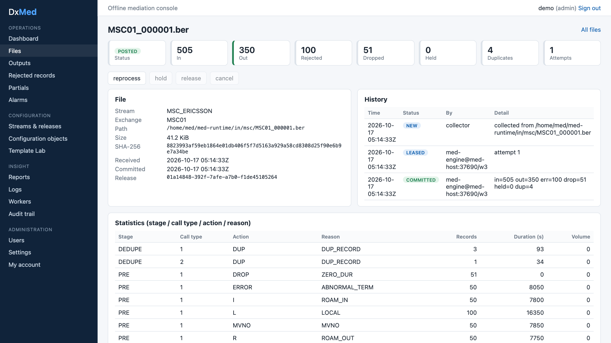 |
| Input files with reconciliation counters | File detail: history, per-stage statistics, outputs |
| 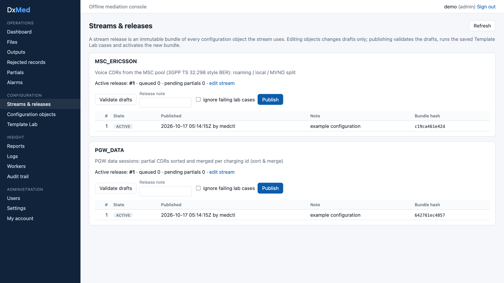 | 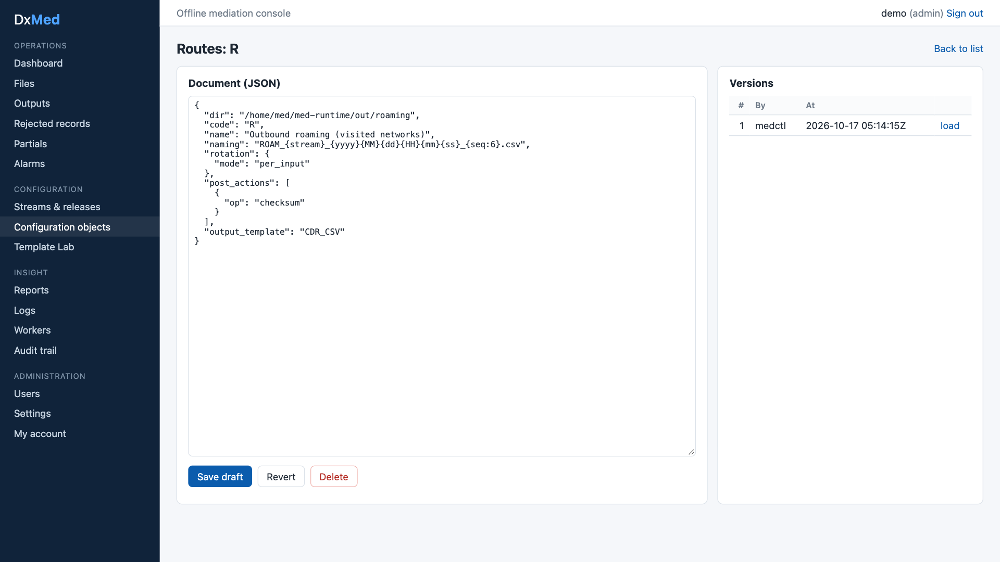 |
| Streams and releases | Configuration editor with version history |
| 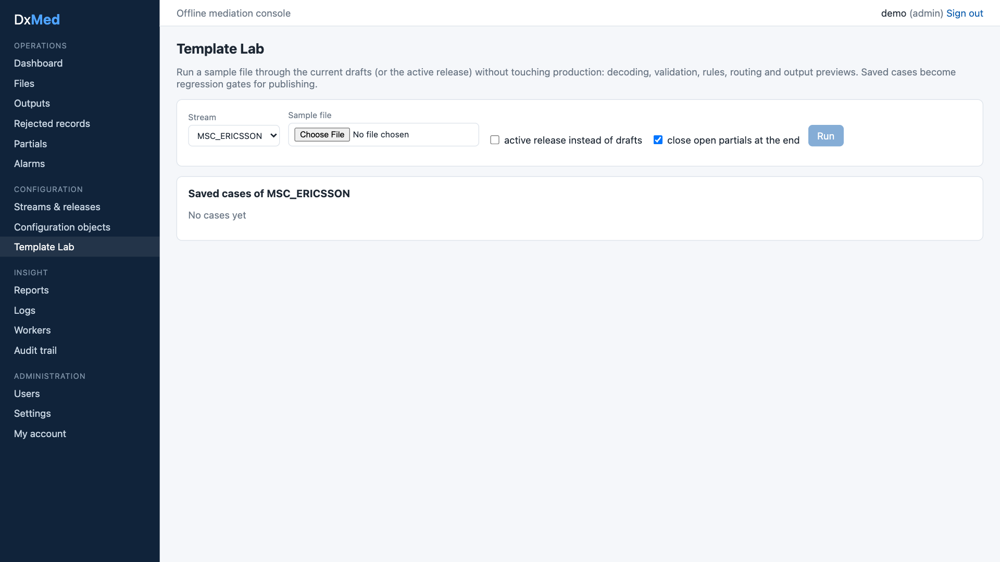 | 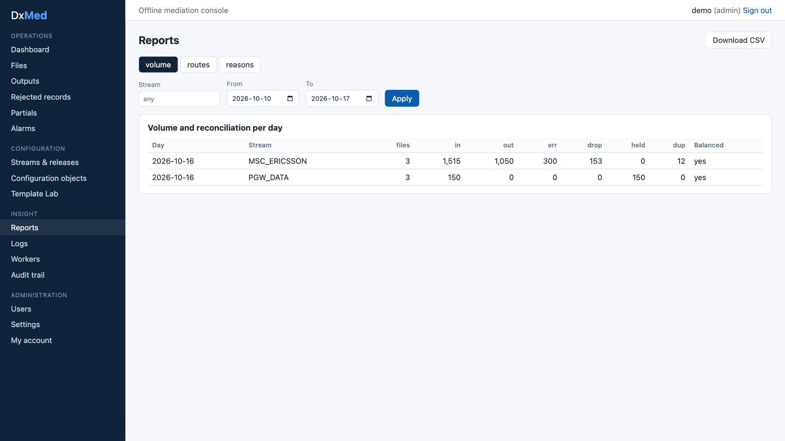 |
| Template Lab | Daily volume and reconciliation |

Roles: **viewer**, **operator** (reprocess, hold, release, cancel, re-drive), **configurator** (edit, Lab),
**publisher** (publish, activate, audit) and **admin** (users, settings).

## Documentation

| Document | Markdown | Word | PDF |
|---|---|---|---|
| High-level design | [md](docs/DxMed_HLD.md) | [docx](docs/DxMed_HLD.docx) | [pdf](docs/DxMed_HLD.pdf) |
| Low-level design | [md](docs/DxMed_LLD.md) | [docx](docs/DxMed_LLD.docx) | [pdf](docs/DxMed_LLD.pdf) |
| Operations guide | [md](docs/DxMed_Operations_Guide.md) | [docx](docs/DxMed_Operations_Guide.docx) | [pdf](docs/DxMed_Operations_Guide.pdf) |

The Word and PDF files are generated from the Markdown by `scripts/build-docs.sh` (pandoc, mermaid-cli and
headless Chrome).

## Quick start

You need Go 1.26 or later (`go.mod` pins toolchain 1.27.2, which Go downloads automatically), Node.js 22 and
a PostgreSQL 18 cluster. The scripts expect the DxPS cluster helpers at `$DXPS_SCRIPTS` (default
`~/DxPS/dxps/scripts`). Runtime files go to `~/med-runtime`.

```bash
scripts/infra-setup.sh   # roles, schema, secrets, dev certificates, migrations, admin user, sample config
scripts/run-all.sh       # build and start all components
scripts/status.sh        # pid, port and health of each component
```

Open `https://localhost:8090` and sign in as `admin`. The password is `MED_ADMIN_PASSWORD` in
`~/med-runtime/secrets.env`. Generate sample input with
`~/med-runtime/bin/medctl gen msc --dir ~/med-runtime/in/msc --files 3 --records 500`.
See the [operations guide](docs/DxMed_Operations_Guide.md) for daily operations and troubleshooting.

| Listener | Address |
|---|---|
| Console | `https://localhost:8090` |
| API | `https://localhost:8543` (`/healthz`, `/readyz`) |
| Metrics | `127.0.0.1:9301` (engine), `127.0.0.1:9302` (collector) |

## Repository layout

| Path | Content |
|---|---|
| `cmd/` | The four Go binaries |
| `internal/` | Engine packages (decode, transform, filter, merge, dedupe, route, encode, pipeline, …), store, API, auth |
| `ui/` | Next.js console and its vitest tests |
| `scripts/` | Setup, run, stop, status, tests, security scan, document build |
| `tools/covergate` | Coverage gate used by the test scripts |
| `docs/` | HLD, LLD, operations guide, screenshots |

## Tests

```bash
scripts/test-all.sh      # Go unit + integration tests, UI tests, coverage gates
scripts/sec-scan.sh      # govulncheck, go vet, npm audit, secret scan of tracked files
```

Coverage gates: 100% for the engine packages, at least 95% for Go overall (currently 97.3%), and at least 90%
for the UI (currently 99.8% of statements).

## License

[Apache License 2.0](LICENSE).
