| Item | Value |
|---|---|
| Document | DxMed HLD, version 1.0 (as built) |
| Date | 17 October 2026 |
| Status | **Approved** on 16 October 2026 with the default decisions D1–D8 (§15); updated to match release 1.0 |
| Companions | `DxMed_LLD.md` (low-level design), `DxMed_Operations_Guide.md` (install, run, use) |
| Source | Go module `dxmed` + Next.js UI in `ui/` |

**Change history**

| Version | Date | Change |
|---|---|---|
| 0.9 | 16 Oct 2026 | Design for approval |
| 1.0 | 17 Oct 2026 | Approved as is. Updated to the implemented system: component layout, pipeline order, release-1.0 scope table (§3.3), UI screenshots (§8), measured coverage (§12), resolved decisions (§15) |

---

## 1. Purpose and scope

DxMed is an **offline (batch, file-based) CDR mediation platform**. It collects raw CDR files from network
elements, decodes them (ASN.1 BER, binary blocks, fixed-width, CSV, tagged text, JSON, XML), validates,
filters, de-duplicates, sorts and merges partial records, enriches them, and writes classified output files
such as **roaming**, **local**, **MVNO**, **rejected** and **duplicate** files for billing and other downstream
systems.

Everything that Readg configured through Oracle tables and tab-separated rule files is configured from a
**web UI**, using **templates**: decoding templates, rule sets, transform groups, lookup tables, merge
profiles, routes and output templates. Configuration is versioned, can be tested offline against sample files
(Template Lab) and is published to the engine without code changes or restarts.

**In scope:** collection, decoding, validation, filtering and transformation, record and file de-duplication,
sort and merge, enrichment by lookups, output generation and post-actions, statistics, reporting, logging,
audit, alarms, the web UI and the operations CLI.

**Out of scope:** online/real-time charging (Diameter Gy/Ro), rating, invoicing, TAP3 rating logic.

---

## 2. The "cocktail": what we take from each reference

Both references were studied: Readg 6.11 (C / Oracle Pro\*C) and CGRateS (Go). DxMed is a clean-room
implementation: no source code from either was copied.

| Capability | Readg 6.11 | CGRateS (ERs/EEs/FilterS) | DxMed |
|---|---|---|---|
| Binary / ASN.1 decoding | **Strong.** Tag table (`CDR_DEF`) with ~60 data types, header/trailer, blocks, EBCDIC | None | **Readg model** as a typed BER/TLV and binary-block decoder driven by a template tree; 28 data types |
| Text formats | Lines, CSV, tagged ASCII | CSV, FWV, XML, JSON with field templates | **CGRateS-style field templates** for CSV, FWV, tagged, JSON and XML |
| Field mapping | Fixed positions in an 800-byte ASCII record | Named paths | **Named fields** with dotted paths (`location.lac`) |
| Filtering | **Strong.** Call type → ordered conditions (OR) → items (AND); actions, reason codes, transform groups, stop/continue/error | Rich operator set (`*prefix`, `*regex`, `*ipnet`…) | **Readg rule structure** with the **CGRateS operator set** added (37 operators) |
| Field transforms | `CDR_FILTER_GROUP` functions | Converters | **Union of both**: 40 functions |
| Sort & merge | **Strong.** SORT, RELATE, MERGE_COND, MERGE_RULE, close times, COL/UNCOL stages | Partial cache TTL and expiry action | **Readg algorithm** + **CGRateS TTL/expiry**, crash-safe state in PostgreSQL |
| Duplicates | File level: sequence and date range per exchange | Record level by origin id | **Both**: file level (name, checksum, sequence range, time range, gap) and record level (hashed key) |
| Output routing | Per action suffix: directory, format, header/trailer; post-actions | Many exporters | **Readg routing by action**; writers CSV, FWV, lines, JSON lines, XML, BER; post-actions checksum, gzip, copy, move, delete |
| Statistics | Per file × call type × action × reason | Stats/metrics services | Readg statistics model + Prometheus metrics + UI reports |
| Config & ops | Oracle tables; one process per instance | JSON config, API, HA | UI + REST API, versioned config and immutable releases in PostgreSQL, multi-worker with row leasing |

> **Licence note.** CGRateS is licensed **AGPL-3.0**. DxMed uses it **as a design reference only**: no CGRateS
> code is copied or linked, and the reference clone is never committed or shipped.

---

## 3. Requirements

### 3.1 Functional requirements

| ID | Requirement |
|---|---|
| FR-01 | Collect files from source directories; detect complete files (stable size and time, or done-marker); register each file with its SHA-256 |
| FR-02 | Decode ASN.1 BER (definite and indefinite length, multi-byte tags, constructed types), fixed-length binary blocks with header/trailer, EBCDIC, tagged text, CSV, fixed-width text, JSON and XML |
| FR-03 | Decoding is **template based** and edited from the UI |
| FR-04 | Validate records (mandatory, kind, range, regex); invalid records go to the error route with a reason code instead of failing the file |
| FR-05 | Filter with rule sets edited in the UI: call type, ordered conditions, AND items, operators, value lists and lookups; actions route / drop / error / hold-for-merge / multi-route; reason code; transform group; stop/continue/error flow |
| FR-06 | Three filter stages like Readg: **PRE** (after decode), **COL** (merged records), **UNCOL** (partials that expired without completing) |
| FR-07 | Field transform library usable in rules |
| FR-08 | File-level duplicate and gap detection; record-level duplicate detection with a configurable key and retention |
| FR-09 | Sort and merge (collapse) of partial CDRs with relate keys, end conditions, merge rules, close times, TTL and maximum partials; pending partials survive restarts |
| FR-10 | Enrichment by lookup tables managed in the UI |
| FR-11 | Outputs by route with formats, header/trailer aggregates, naming patterns and gap-free sequence numbers |
| FR-12 | Output post-actions |
| FR-13 | Statistics per file × stage × call type × action × reason (count, duration, volume) |
| FR-14 | Configuration versioning: draft → validate → test → publish → rollback |
| FR-15 | **Template Lab:** run a sample file through draft configuration without touching production; saved cases gate publishing |
| FR-16 | Operations from UI: file explorer, reprocess, hold/release, cancel, re-drive, pending partials, manual close |
| FR-17 | Reports: volumes and reconciliation by day and stream, routes, reasons; CSV export |
| FR-18 | Logs and audit in the UI: log search, live tail, audit trail of every change |
| FR-19 | Alarms shown in the UI and exposed as metrics |
| FR-20 | Users and roles (viewer, operator, configurator, publisher, admin) |

### 3.2 Non-functional requirements

| ID | Requirement | Target |
|---|---|---|
| NFR-01 | Throughput | ≥ 50,000 records/s per worker for ~300-byte ASN.1 CDRs (benchmark pending, §3.3) |
| NFR-02 | Horizontal scale | N workers on one or more hosts share the queue; no double processing |
| NFR-03 | Correctness | Exactly-once **per input file**: outputs, statistics, dedupe keys and merge state commit together or not at all |
| NFR-04 | Recovery | A crash at any point resumes cleanly; no partial output file is ever visible downstream |
| NFR-05 | Config change | A publish takes effect at the next file, without restart |
| NFR-06 | Security | TLS on every listener, RBAC, audit, secrets never logged, no shell execution |
| NFR-07 | Test coverage | 100% statements on engine packages; ≥ 95% Go overall; ≥ 90% UI |
| NFR-08 | Platforms | macOS 13+ and Ubuntu 22.04/24.04 |
| NFR-09 | Offline operation | No internet needed at run time; all UI assets served locally |

### 3.3 Release 1.0 scope

| ID | Status | Notes |
|---|---|---|
| FR-01 | Delivered (directory) | SFTP pull is planned; today an external `sftp`/`rsync` job can feed the source directory |
| FR-02, FR-03 | Delivered | Formats `ber`, `binblock`, `csv`, `fwv`, `tagged`, `json`, `xml`; 28 data types incl. `EBCDIC` |
| FR-04 … FR-09 | Delivered | |
| FR-10 | Delivered | Lookup tables (`set`, `map`, `prefix`) are configuration objects, so they are versioned and released with the stream. CSV import is planned |
| FR-11 | Delivered | Writers `csv`, `fwv`, `lines`, `jsonl`, `xml`, `ber`. Database-table output is planned |
| FR-12 | Delivered (local) | `checksum`, `gzip`, `copy`, `move`, `delete`. SFTP push is planned; hooks are deliberately not provided |
| FR-13 | Delivered | |
| FR-14 | Delivered | Version history per object, immutable releases, activate an older release (rollback), bundle export (JSON). Bundle import is planned |
| FR-15 | Delivered | Decoded samples, rule trace, output previews, reconciliation check; saved cases gate publishing |
| FR-16 | Delivered | |
| FR-17 | Delivered | Volume, routes and reasons reports with CSV export. XLSX/PDF export is planned |
| FR-18 | Delivered | Live tail over Server-Sent Events |
| FR-19 | Delivered | Rules `queue_depth`, `dead_files`, `seq_gap`; acknowledge from the UI. Disk-space and "no file in N minutes" rules are planned |
| FR-20 | Delivered | |
| NFR-01 | **Open** | Benchmarks per stage still to be written and run |
| NFR-02 … NFR-06, NFR-09 | Delivered | |
| NFR-07 | Delivered | Measured: Go 97.3% overall, every engine package 100%; UI 99.85% statements (§12) |
| NFR-08 | Delivered on macOS | Ubuntu scripts follow the DxPS conventions but were not run in this release |

---

## 4. Architecture overview

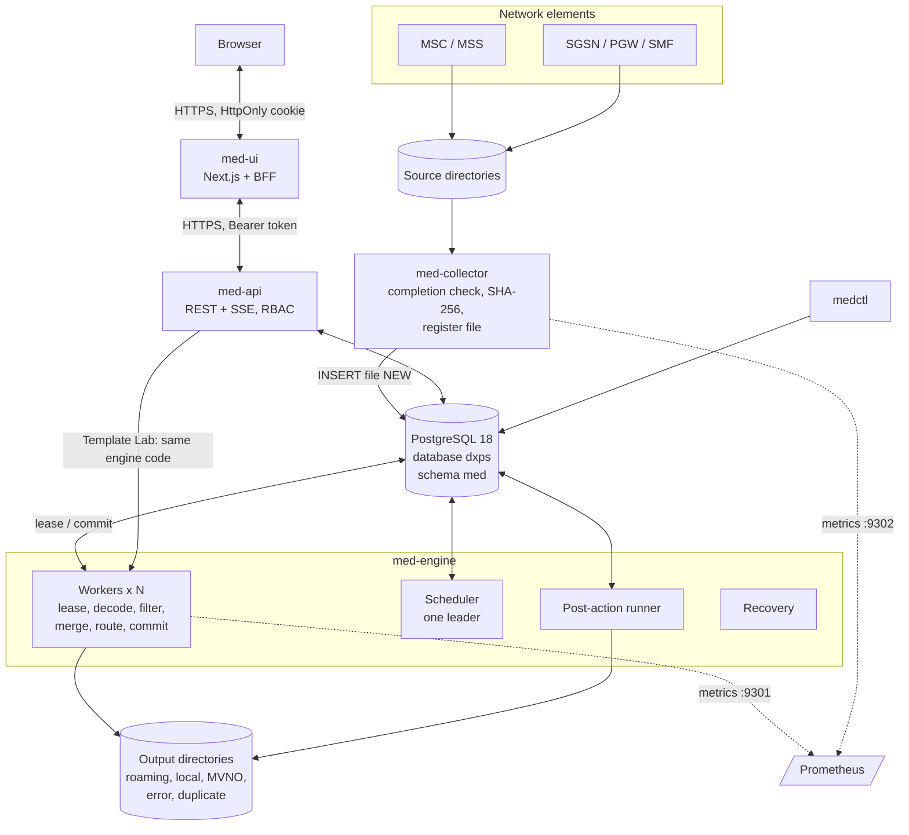

### 4.1 Components

| Component | Language | Role |
|---|---|---|
| `med-collector` | Go | Scans each enabled stream's source directory, waits until a file is complete, computes SHA-256 and registers it as `NEW` |
| `med-engine` | Go | Runs N workers that lease files and run the pipeline (§5); also the post-action runner, crash recovery and the scheduler. Several engines may run; one is scheduler leader |
| Scheduler (inside `med-engine`) | Go | Leader by lease row in `med.leader`. Resets expired leases, retries failed files with back-off, marks files `POSTED`, keeps daily partitions 7 days ahead, applies retention, flushes expired partials, evaluates alarms |
| `med-api` | Go | REST API for configuration, releases, Template Lab, operations, reports, logs (SSE), alarms, users and settings; authentication and RBAC; audit |
| `med-ui` | TypeScript (Next.js 16, React 19) | Web console. Its server is a backend-for-frontend: it holds the session in an HttpOnly cookie and forwards calls to `med-api` |
| `medctl` | Go | CLI: `migrate`, `bootstrap`, `seed`, `publish`, `user`, `gen` (sample CDR files), `partitions`, `status` |
| PostgreSQL 18 | — | **Same cluster and database as DxPS** (`localhost:5433`, database `dxps`), schema `med`, own roles |

All Go components come from **one Go module** and share the engine packages. Template Lab in `med-api` runs
the same pipeline code as the workers, so a Lab result is what production will do.

---

## 5. Processing pipeline

#### Part 1 — intake, decoding and the PRE stage

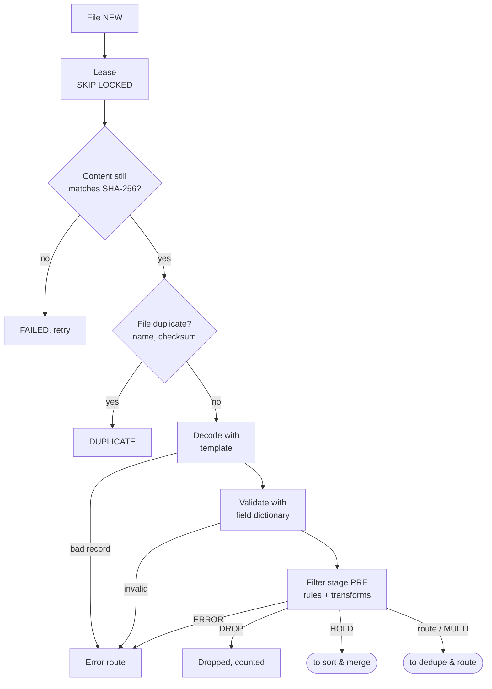

#### Part 2 — sort & merge, dedupe, routing and commit

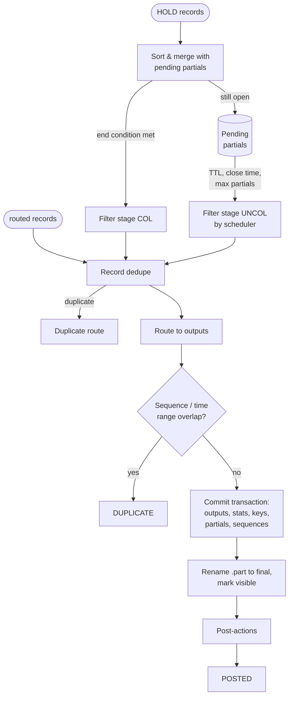

Key behaviours:

1. **Stream.** Every source belongs to a *stream* (Readg's association). A stream binds source → decoding
   template → field dictionary → rule set → merge profile → lookups → routes.
2. **Per-record error isolation.** A bad record never fails the file; it goes to the error route with a
   reason code (`DECODE:…`, `VALIDATION:…`, `NO_RULE`, or the rule's reason). A file fails only on structural
   problems (unreadable, content changed, no plan) or when a rule with flow `error` fires.
3. **Two-pass rules** (from Readg): the general block (`*any`) runs first; then the block of the record's call
   type, unless a general condition stopped evaluation.
4. **Sort & merge** holds partials across files until the end condition, a close time, the TTL or the partial
   limit. Files of a merge stream are processed one at a time (advisory lock) so partial state stays consistent.
5. **Commit protocol:** outputs are written as `.part` files in `<dir>/.tmp`; one transaction stores output
   rows, statistics, dedupe keys, partial state and route sequences; then files are renamed into place.
   Downstream systems never see a half-written file (LLD §9).
6. **Reconciliation:** for every file `in = out + err + drop + held + dup`; the reports page shows it per day.

### 5.1 File lifecycle

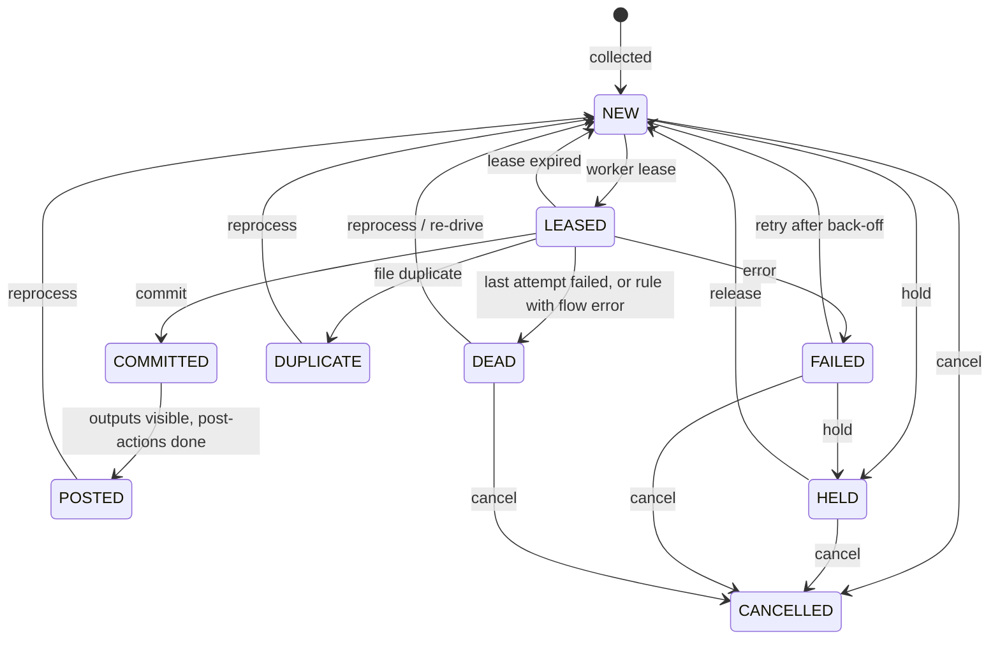

---

## 6. Configuration model

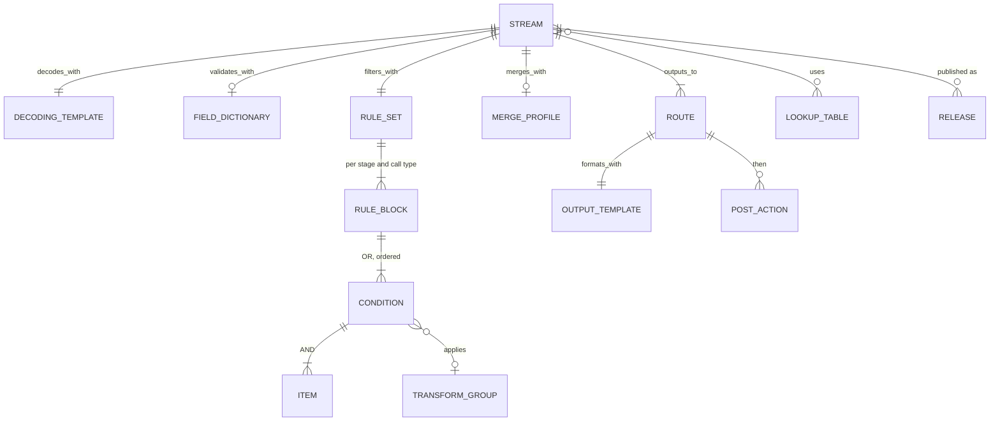

| Object (kind) | Readg equivalent | Purpose |
|---|---|---|
| `stream` | Association, `CDR_INFO` | Source directory and pattern, completion rule, objects used, dedupe policy, error and duplicate routes |
| `decoding_template` | `CDR_DEF`, `CDR_HEADER_TRAILER` | Format, header/trailer/blocks, tag/field tree with data types, exchange id and sequence from the file name |
| `field_dictionary` | Output positions | Field names with kind, mandatory, range and regex checks |
| `rule_set` | `CDR_FILTER_HEAD`, `CDR_FILTER` | Ordered rules per stage (PRE, COL, UNCOL) and call type |
| `transform_group` | `CDR_FILTER_GROUP` | Ordered field functions applied when a rule fires |
| `lookup_table` | `VALIN`, `VALDB`, `LOOKP` | `set`, `map` or `prefix` (longest match) tables |
| `merge_profile` | `CDR_GROUP_DATA_SETUP`, `CDR_CLOSING_PARAMETERS` | Sort, relate, end condition, merge rules, close times, TTL, max partials, expiry policy |
| `route` | `CDR_PROCESSING_OUTPUT` | Action code → output template, directory, naming, rotation, post-actions |
| `output_template` | Output layouts | Writer format, fields, header/trailer with aggregates |

**Versioning.** Every save creates a new version of the object (history kept, any version can be loaded
back). Publishing a stream validates all referenced objects, runs the stream's saved Template Lab cases,
then stores an immutable **release** (a bundle of all objects with its SHA-256) and activates it. Every
processed file records the release it used. Activating an older release is the rollback.

**Example — roaming vs local split** (stream `MSC_ERICSSON`, stage PRE, call type 1):

| Cond | Field | Operator | Value | Action | Reason |
|---|---|---|---|---|---|
| general 1 | `duration_s` | `=` | `0` | `DROP` | `ZERO_DUR` |
| general 2 | `cause_for_term` | `*in` | `98, 99` | `ERROR` | `ABNORMAL_TERM` |
| 1 | `served_imsi` | `*notprefix` | lookup `home_plmn` | `R` (outbound roaming) | `ROAM_OUT` |
| 2 | `msc_id` | `*notin` | lookup `home_msc` | `I` (inbound roamer) | `ROAM_IN` |
| 3 | `served_msisdn` | `*prefix` | lookup `mvno_ranges` | `MVNO` + transform `TG_MVNO` | `MVNO` |
| default | — | — | — | `L` (local) | `LOCAL_MO` |

---

## 7. Data and database

**Same PostgreSQL as DxPS:** cluster `localhost:5433` (TLS, verify-full against the DxPS CA,
SCRAM-SHA-256), database `dxps`, schema `med`. DxMed never reads DxPS tables (decision D3).

| Role | Rights |
|---|---|
| `med_owner` | Owns schema `med`, runs migrations |
| `med_app` | Run-time read/write (engine, collector, API) |
| `med_ops` | Operations tasks; member of `med_reader` |
| `med_reader` | Read-only for reporting tools |

Table groups (DDL in LLD §10):

- **Configuration:** `config_object` (all versions), view `config_current`, `release`, `lab_case`, `setting`.
- **Processing:** `file` (job queue and lifecycle), `file_event`, `file_seq_range`, `file_stat`,
  `output_file`, `route_seq`, `record_key`, `partial_record`, `error_record`, `post_action_job`.
- **Observability and security:** `event_log`, `audit_log`, `alarm`, `app_user`, `session`, `worker`, `leader`.

High-volume tables (`file_stat`, `record_key`, `error_record`, `event_log`) are **partitioned by day**; the
scheduler creates partitions 7 days ahead and drops old ones by retention. CDR contents live in output files,
not in the database; only rejected records keep their raw bytes (for the hex view).

---

## 8. User interface

Next.js 16 / React 19 / TypeScript, served over HTTPS on `https://localhost:8090`. The browser only talks to
the UI server; the UI server forwards `/bff/*` to `med-api` with the user's token. Pages are shown or hidden by
role, and the API enforces the same roles.

| Area | Pages |
|---|---|
| Operations | Dashboard, Files (and file detail), Outputs, Rejected records, Partials, Alarms |
| Configuration | Streams & releases, Configuration objects (list, JSON editor with version history, copy from template), Template Lab |
| Insight | Reports (volume, routes, reasons; CSV), Logs (search, live tail), Workers, Audit trail |
| Administration | Users, Settings, My account (password change) |

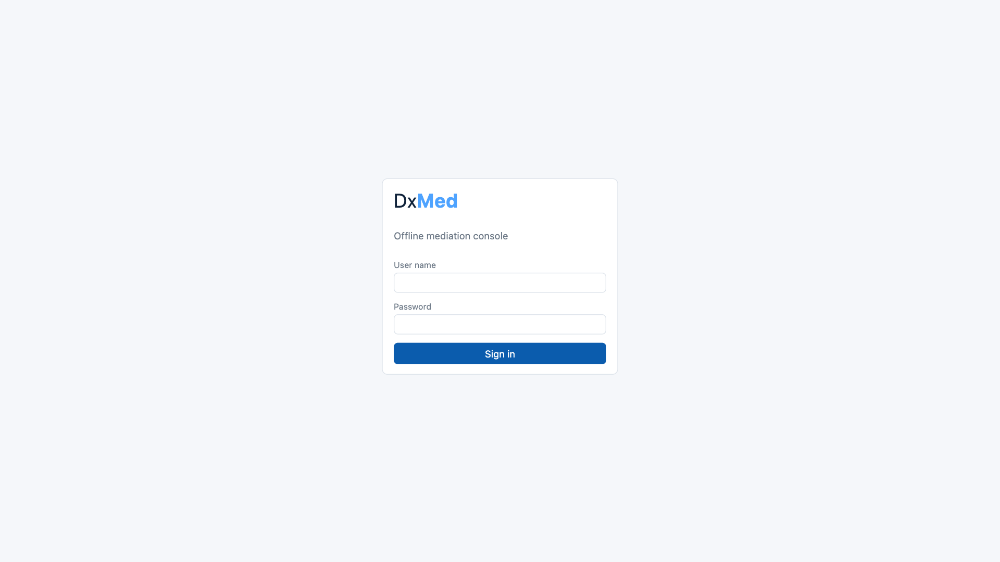

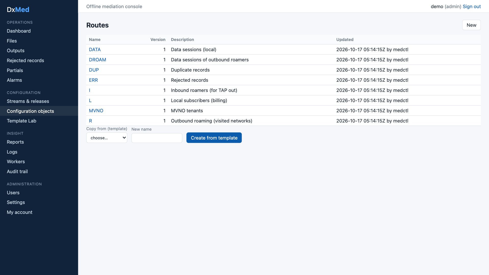

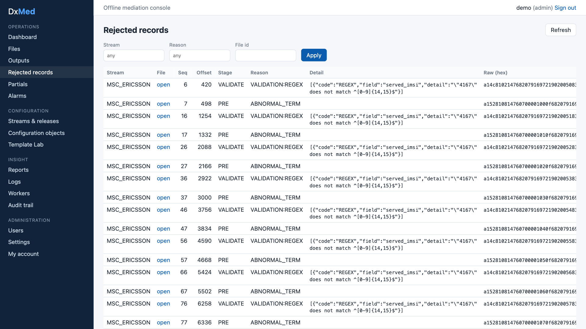

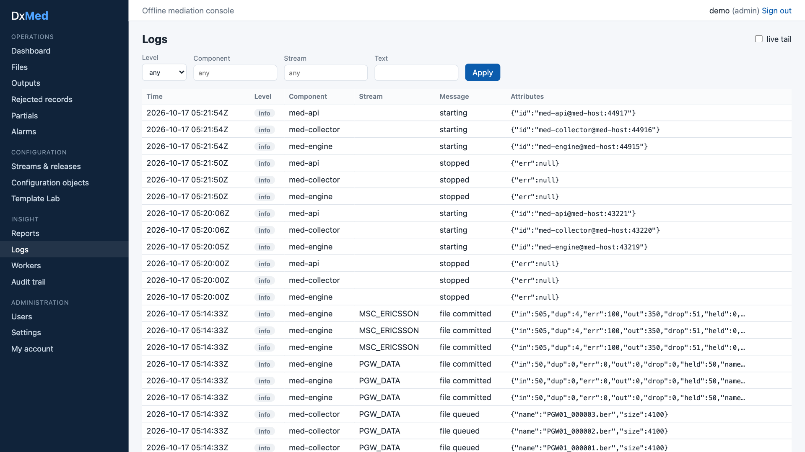

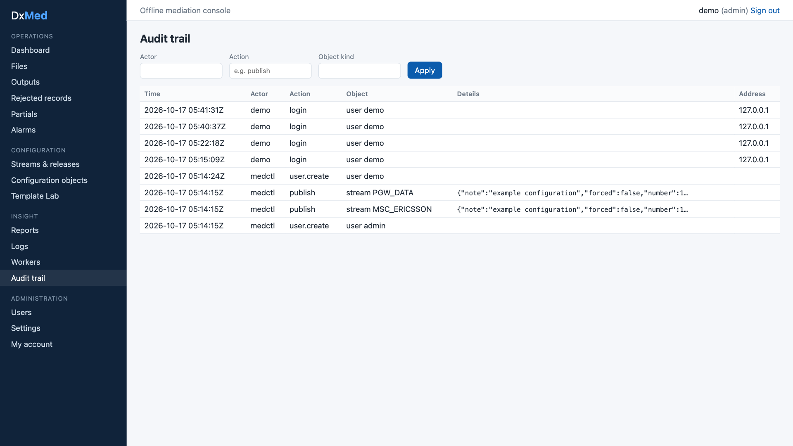

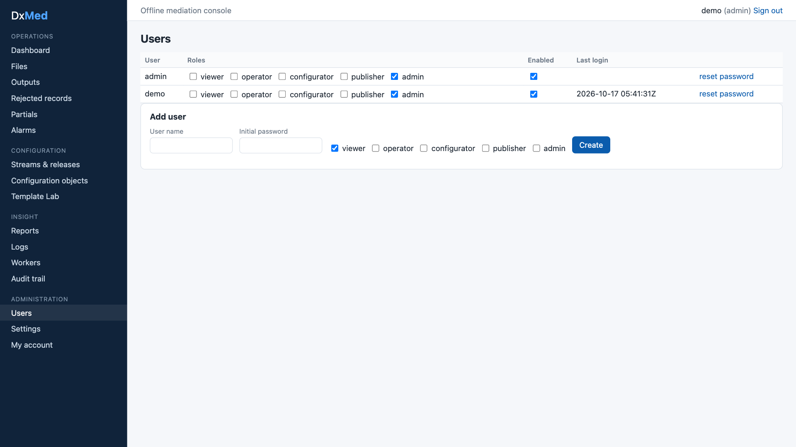

---

## 9. Observability, logging and reporting

- **Logs:** JSON (`log/slog`) to `~/med-runtime/logs/<component>.log` and, from `info` level, to
  `med.event_log` for search and live tail in the UI. IMSI/MSISDN-like attributes are masked
  (`416770******321`) unless `MED_LOG_NOMASK=1`.
- **Metrics:** Prometheus text endpoint per component: engine `127.0.0.1:9301`, collector `127.0.0.1:9302`
  (files, records by disposition, outputs, queue depth, pending partials, file duration, alarms, post-action
  failures; collector files and scan errors).
- **Statistics:** per file × stage × call type × action × reason × stream with count, duration and volume.
- **Reconciliation:** per file and per day (`in = out + err + drop + held + dup`).
- **Audit:** every configuration change, publish, activation, file action, user change and login, with
  actor, IP and before/after.
- **Workers:** each component heart-beats into `med.worker` (host, pid, version).

---

## 10. Reliability and recovery

| Concern | Design |
|---|---|
| Double processing | Files are leased with `FOR UPDATE SKIP LOCKED` and a lease expiry, renewed by heartbeat; the commit checks the lease owner, so a worker that lost its lease cannot commit |
| Partial outputs | `.part` files + atomic rename after commit; recovery finishes interrupted renames and removes orphans |
| Merge state | `med.partial_record` is updated in the same transaction as the file commit; merge streams are serialised by an advisory lock |
| Poison files | Retry with back-off, then `DEAD`; reprocess or re-drive from the UI |
| Changed input | The engine re-checks SHA-256 before processing |
| Config errors | Publish requires validation and passing Template Lab cases (admins may force) |
| Edited migrations | Migrations are checksummed; a changed, already-applied migration stops start-up with a clear error |
| Leader tasks | Scheduler leadership is a lease row with expiry; another engine takes over automatically |

---

## 11. Security

- TLS (minimum 1.2) for UI and API; PostgreSQL over TLS with full verification; loopback binding by default.
- Local users with **Argon2id** password hashes; login limiter (5 failures per 5 minutes per IP and user);
  sessions stored only as token hashes, 8-hour lifetime; password change ends other sessions.
- UI session in an HttpOnly, Secure, SameSite=Strict cookie; mutations require an anti-CSRF header;
  Content-Security-Policy and other security headers on UI and API.
- RBAC per API route: viewer < operator < configurator < publisher < admin.
- Optimistic locking (ETag / If-Match) on configuration objects; request body limit 16 MiB; strict JSON
  decoding; CSV exports guarded against formula injection.
- No shell execution: Readg's `EXEC` post-action is not carried over.
- Secrets in `~/med-runtime/secrets.env` (mode 600), never logged, never returned by the API.
- `scripts/sec-scan.sh`: `govulncheck`, `go vet`, `npm audit`, secret patterns in tracked files.

---

## 12. Testing strategy and measured coverage

| Layer | Tooling | Gate | Measured (release 1.0) |
|---|---|---|---|
| Engine packages: `model`, `datatype`, `ber`, `decode`, `encode`, `transform`, `filter`, `lookup`, `validate`, `dedupe`, `merge`, `route`, `config`, `pipeline`, `lab`, `sample`, `obs` | `go test -race`, table tests, golden files, Go fuzzing (`ber`, `decode`, `datatype`) | **100%** | **100%** each |
| Service packages: `store`, `engine`, `api`, `app`, `ctl`, `ops`, `auth`, `collector`, `postaction` | Unit tests with temp dirs and injected clocks; integration tests against a throw-away database `dxmed_test` on the same cluster | — | store 91.9%, engine 83.1%, api 98.0%, app 98.6%, ctl 96.2%, ops 96.4%, auth 96.5%, collector 98.8%, postaction 97.9% |
| Whole Go module | `tools/covergate` (merged profiles) | ≥ 95% | **97.3%** |
| UI | Vitest + Testing Library (all pages, BFF proxy, library) | ≥ 90% | **99.85%** statements, 98.4% branches |

`scripts/test-all.sh` runs everything and fails below a gate. End-to-end behaviour was verified on the live
stack with the sample data set (6 files, 1,665 records, all reconciled).

---

## 13. Deployment and operations

Runtime directory `~/med-runtime` (binaries, logs, pid files, spool directories, PKI, secrets). Shared
PostgreSQL cluster of DxPS.

| Listener | Address |
|---|---|
| UI (HTTPS) | `https://localhost:8090` |
| API (HTTPS) | `https://localhost:8543` |
| Metrics | `127.0.0.1:9301` (engine), `127.0.0.1:9302` (collector) |

These do not clash with DxPS. Scripts: `infra-setup.sh`, `run-all.sh`, `status.sh`, `stop.sh`,
`test-all.sh`, `sec-scan.sh`, `reset-db.sh` (development only). See the Operations Guide.

---

## 14. Roadmap after 1.0

| Item | Notes |
|---|---|
| Benchmarks (NFR-01) | Per-stage `go test -bench` and a 10M-record load test |
| SFTP pull and push | Collector source type `sftp`; post-action `sftp_push` |
| Bundle import, release diff | Offline transfer between environments |
| Lookup CSV import, XLSX/PDF reports | UI and API |
| More alarm rules | Disk space, no file received in N minutes, error ratio |
| Structured editors | Tree editor for templates, rule grid, hex viewer (today: JSON editor + Lab) |
| Optional | TAP3/RAP output, Kafka exporter, OIDC login, Readg configuration importer |

---

## 15. Decisions (resolved)

| # | Topic | Decision |
|---|---|---|
| D1 | Meaning of "offline" | Batch/file mediation plus offline configuration (drafts, Template Lab, releases, no internet needed) |
| D2 | Shared database | Same DxPS cluster and database `dxps`, schema `med`, roles `med_owner`, `med_app`, `med_ops`, `med_reader` |
| D3 | Reading DxPS data | No direct read; DxMed keeps its own lookup tables |
| D4 | UI technology | Next.js (TypeScript, React); plain CSS components, no external UI kit |
| D5 | Coverage gate | 100% engine packages, ≥ 95% Go overall, ≥ 90% UI |
| D6 | First CDR formats | Generic 3GPP-style samples: MSC voice (BER) and PGW data with partials (BER) |
| D7 | Readg configuration import | Not in release 1.0 |
| D8 | Product name | DxMed |
