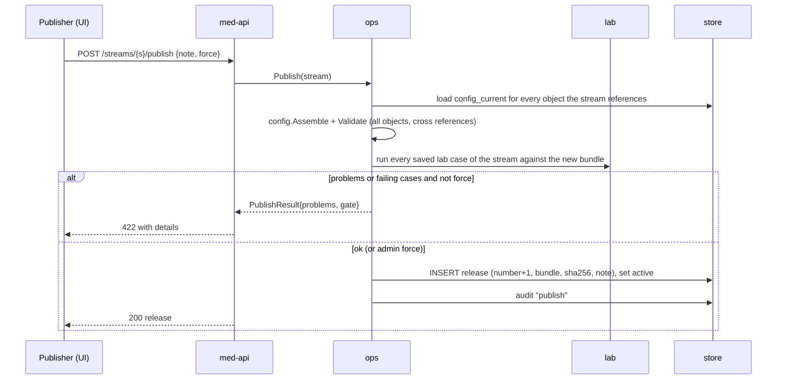
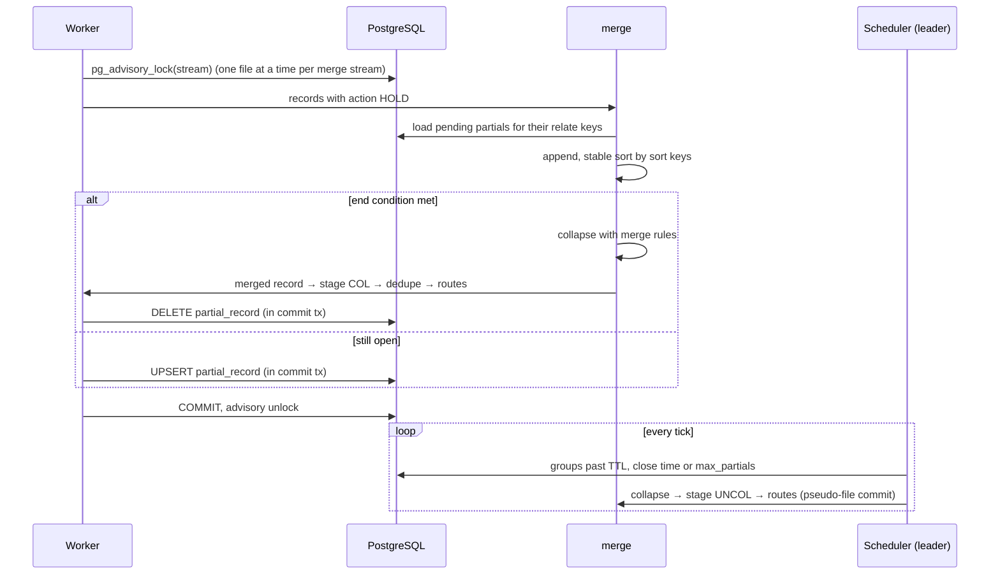
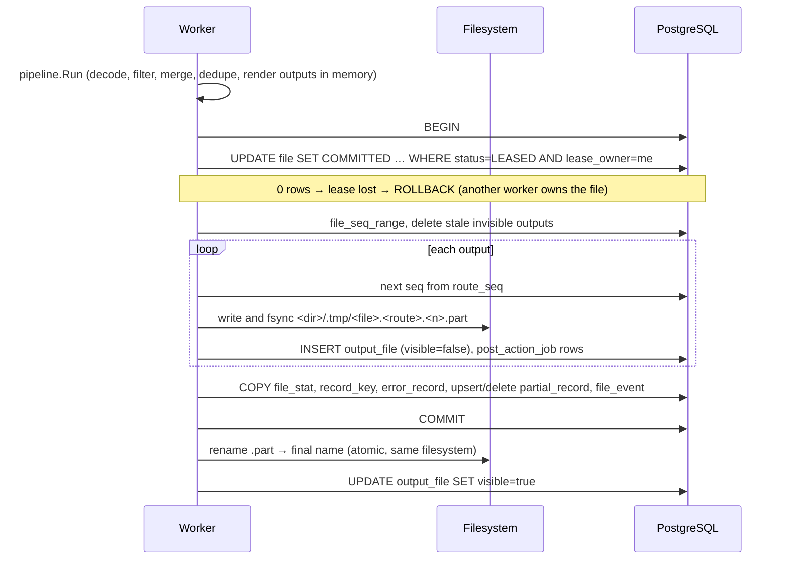
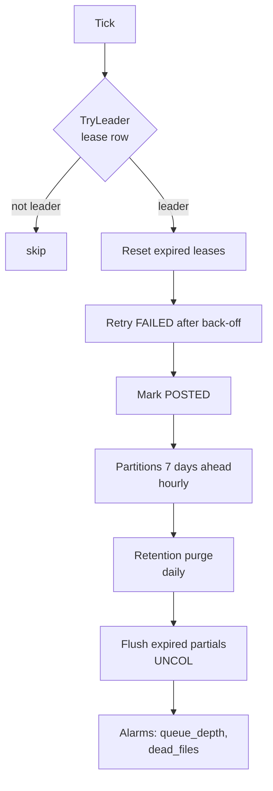
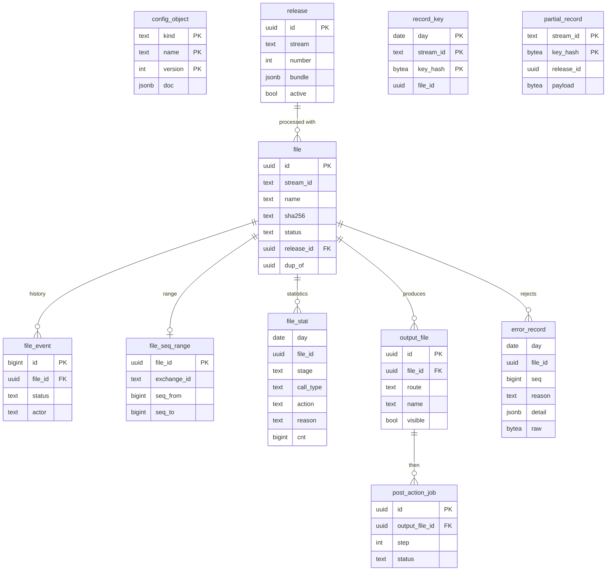
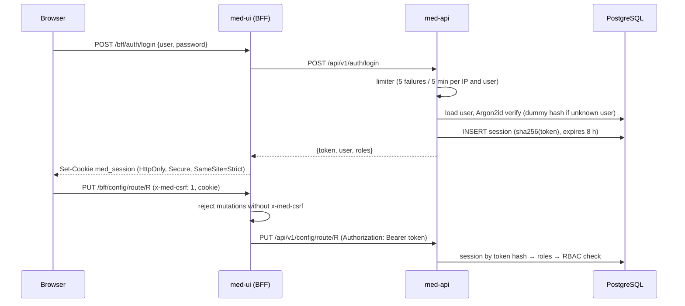

| Item | Value |
|---|---|
| Document | DxMed LLD, version 1.0 (as built) |
| Date | 17 October 2026 |
| Status | **Approved** (16 October 2026); updated to the implemented release 1.0 |
| Read with | `DxMed_HLD.md` (requirement ids FR-xx / NFR-xx), `DxMed_Operations_Guide.md` |

**Change history**

| Version | Date | Change |
|---|---|---|
| 0.9 | 16 Oct 2026 | Design for approval |
| 1.0 | 17 Oct 2026 | Rewritten to match the code: package layout, configuration schemas, operators and functions, commit transaction, scheduler, schema, API routes and roles, UI/BFF, test results |

---

## 1. Repository layout

```
Mediation/
  go.mod                  module dxmed (Go 1.26): pgx/v5, shopspring/decimal, zeebo/xxh3, x/crypto
  cmd/
    med-engine/  med-collector/  med-api/  medctl/        thin mains (signal handling, app.Run / ctl.Main)
  internal/
    model/       Value, Record, FieldError                                   engine, 100%
    datatype/    28 data type codecs (§4.3)                                   engine, 100%
    ber/         streaming BER/TLV reader and writer                          engine, 100%
    decode/      format drivers: ber, binblock, csv, fwv, tagged, json, xml   engine, 100%
    validate/    field dictionary checks                                       engine, 100%
    transform/   40 field functions (§5)                                      engine, 100%
    lookup/      set / map / prefix tables                                     engine, 100%
    filter/      rule compiler + evaluator, 37 operators, trace (§6)          engine, 100%
    dedupe/      file-level and record-level duplicate logic (§7)             engine, 100%
    merge/       sort & merge, merge functions, partial encoding (§8)         engine, 100%
    route/       routing, naming patterns, rotation (§9)                      engine, 100%
    encode/      writers csv, fwv, lines, jsonl, xml, ber; header/trailer      engine, 100%
    config/      object schemas, validation, release bundle, compile to Plan  engine, 100%
    pipeline/    per-file orchestration of the stages above                    engine, 100%
    lab/         Template Lab runner and saved-case gate                       engine, 100%
    sample/      example configuration + MSC/PGW sample file generators        engine, 100%
    obs/         slog JSON logger with masking and DB sink, Prometheus registry engine, 100%
    auth/        roles, Argon2id hashing, session tokens
    collector/   directory scanning and completion detection
    postaction/  checksum, gzip, copy, move, delete runner
    store/       PostgreSQL access, embedded migrations, leasing, commit, queries
    engine/      worker loop, commit/rename, recovery, scheduler
    ops/         publish, validate, activate, file actions (shared by API and medctl)
    api/         REST + SSE handlers, auth, RBAC, audit
    app/         process wiring for med-engine, med-collector, med-api
    ctl/         medctl commands
    dbtest/      test database helper (not shipped)
  tools/covergate/   coverage gate (strict package list + overall minimum)
  ui/                Next.js application (§15)
  scripts/           env.sh, infra-setup.sh, run-all.sh, status.sh, stop.sh, test-all.sh, gotest.sh,
                     sec-scan.sh, reset-db.sh, build-docs.sh
  docs/              HLD, LLD, Operations Guide (Markdown sources, Word and PDF), img/
```

Engine packages are pure Go: no database, network or clock access. This is why they reach 100% coverage and
run unchanged in Template Lab. All I/O sits in the service packages.

---

## 2. Core data model

```go
type Kind uint8 // KNull, KString, KInt, KUint, KDecimal, KBytes, KTime, KDuration, KBool, KIP, KList

type Value struct {
    Kind Kind
    S    string          // KString, KIP (canonical text)
    I    int64           // KInt, KBool (0/1)
    U    uint64          // KUint
    D    decimal.Decimal // fixed point: no float rounding in charging fields
    B    []byte
    T    time.Time
    Dur  time.Duration
    List []Value
}

type Record struct {
    Stream, FileID     string
    Seq, Offset        int64          // position in the input file (1-based) and byte offset
    Length             int
    RecordType         string         // e.g. moCallRecord, from the template
    CallType           string         // selects the rule block (Readg CallType)
    Fields             map[string]Value
    Raw                []byte         // original bytes (kept for rejected records)
    Action, Reason     string         // set by the filter
    Errs               []FieldError   // {Field, Code, Detail}
}
```

Field names are flat (`served_imsi`) or dotted for constructed elements (`location.lac`). The pipeline adds
`file.name` and `file.exchange_id` to every record. Output fields can also read `rec.seq`, `rec.record_type`,
`rec.call_type`, `rec.action`, `rec.reason` and constants (`const:x`).

---

## 3. Configuration objects and releases

Nine kinds are stored as JSON documents in `med.config_object (kind, name, version, doc, updated_by,
updated_at)`. Every save inserts a new version; a `NULL` document marks a deletion; the view
`med.config_current` returns the latest version of each object. The API uses the version as `ETag`, and
`PUT`/`DELETE` require `If-Match`, so two people cannot overwrite each other's edits.

| Kind | Key fields |
|---|---|
| `stream` | `name`, `enabled`, `source{type:"dir", path, pattern, stable_for, done_suffix}`, `decoding_template`, `dictionary`, `rule_set`, `merge_profile`, `routes[]`, `lookups[]`, `dedupe{record_key[], retention, file{name, checksum, seq_range, time_range, gap}, on_range_dup}`, `error_route`, `dup_route`, `duration_field`, `volume_field`, `seq_field`, `time_field` |
| `decoding_template` | `format`, `file{header, trailer, block, exchange_id{regex}, sequence{regex}}`, `records[]{tag, record_type, call_type, fields[]}`, `unknown_tag` |
| `field_dictionary` | `fields[]{name, kind (string, number, time, ip, bool), mandatory, min, max, regex, max_future, max_age}` |
| `rule_set` | `default{action, reason}`, `stages{PRE, COL, UNCOL}[]{call_type, conditions[], default}` |
| `transform_group` | `calls[]{fn, args[]}` |
| `lookup_table` | `kind` (`set`, `map`, `prefix`), `rows{key: value}` |
| `merge_profile` | `sort[]`, `relate[]`, `end_condition[]`, `rules[]`, `close_times[]`, `ttl`, `max_partials`, `on_expiry` |
| `route` | `code`, `name`, `output_template`, `dir`, `naming`, `rotation{mode}`, `post_actions[]` |
| `output_template` | `format`, `header_line`, `header`, `trailer`, `sep`, `root` (xml), `fields[]{name, source, format, default, mandatory, len, align, pad, tag, type}` |

**Publish** (`ops.Publish`, used by API and `medctl publish`):



**Hot reload (NFR-05).** Before each lease the engine reads the active releases (`ActiveReleases`). Compiled
plans (`config.Compile`) are cached by release id, so a new release is compiled once and used from the next
file on. Activating an older release (rollback) works the same way.

---

## 4. Decoding

### 4.1 Decoding template

```json
{
  "name": "ERICSSON_MSC",
  "format": "ber",
  "file": {"exchange_id": {"regex": "^(MSC[0-9]+)_"}},
  "unknown_tag": "ignore",
  "records": [
    {"tag": "[1] C", "record_type": "moCallRecord", "call_type": "1", "fields": [
      {"tag": "[1]", "name": "served_imsi",   "type": "TBCD", "mandatory": true},
      {"tag": "[2]", "name": "served_msisdn", "type": "TBCD", "opts": {"skip_ton_npi": true}},
      {"tag": "[5] C", "name": "location", "type": "STRUCT", "fields": [
        {"tag": "[0]", "name": "lac", "type": "HEX"},
        {"tag": "[1]", "name": "ci",  "type": "HEX"}]},
      {"tag": "[6]", "name": "start_time", "type": "TIME_BCD"},
      {"tag": "[8]", "name": "duration_s", "type": "NUM"},
      {"tag": "[*]", "name": "", "type": "IGNORE"}
    ]}
  ]
}
```

| Format | Field addressing |
|---|---|
| `ber` | `tag`: `[n]` context, `APP n`, `UNI n`, `PRIV n`; suffix `C` = constructed; `[*]` = any other tag |
| `binblock` | `pos`, `len` within fixed-size records; file header/trailer and block size/filler |
| `fwv` | `pos`, `len` characters per line |
| `csv` | `idx` (column) or `header` (column name); separator and quoting options |
| `tagged` | `prefix` (Readg tag-line mode) |
| `json`, `xml` | `path` (dotted path / element path) |

### 4.2 BER reader (`ber`)

`encoding/asn1` only supports DER, so DxMed has its own reader:

1. Identifier: class, constructed bit, tag number (`0x1F` → base-128 multi-byte tag).
2. Length: short form, long form (up to 4 bytes) or indefinite (`0x80`, constructed only) terminated by
   end-of-contents `00 00`.
3. Tag lookup per template level (map `tag → field`); unknown tags follow `unknown_tag` (`ignore` or `error`).
4. Constructed `STRUCT` → recurse; repeated elements → list.
5. Primitive → data type codec (§4.3).
6. Top-level record tags start a new record; `0x00`/`0xFF` filler between records is skipped.
7. Limits: depth 32, element length ≤ remaining bytes. A violation rejects the record with
   `DECODE:<code>` and decoding resumes at the next top-level element when possible.

The reader and the decoders are fuzzed (`go test -fuzz`) for panics and unbounded allocation.

### 4.3 Data types (`datatype`)

| Type | Kind | Decoding |
|---|---|---|
| `TBCD` | String | Telephony BCD, low nibble first, F filler ends; option `skip_ton_npi` |
| `TBCDR` | String | Telephony BCD, high nibble first |
| `BCD` | String | Packed BCD, high nibble first |
| `BCDS` | Int | Signed packed BCD, last nibble C/F = +, D = − |
| `ABCD` | String | BCD with F fillers anywhere (skipped) |
| `HEX` | String | Bytes as upper-case hex |
| `NUM` / `NUMR` | Uint | Unsigned big-endian / little-endian integer |
| `INT` | Int | Two's complement big-endian (ASN.1 INTEGER) |
| `BITS` | Uint | Bit field with mask/shift, or flag names |
| `ASCII` / `ASCIIS` / `ASCIIP` | String | Text as is / trimmed / printable only |
| `EBCDIC` | String | EBCDIC CP037 text |
| `IPADD` | IP | IPv4 (4 bytes) or IPv6 (16 bytes); text form accepted |
| `TIME_BCD` | Time | BCD `YYMMDDhhmmss` with optional sign and `hhmm` offset (3GPP TS 32.298) |
| `TIME_ASC` | Time | ASCII time with layout |
| `TIMEUNX` / `TIMEUNXDEC` | Time | Unix seconds, binary / decimal text |
| `DURATION` / `DURATIONDEC` | Duration | Binary / decimal duration with unit (`s`, `ds`, `cs`, `ms`) |
| `DECIMAL` | Decimal | Decimal text, optional implied scale |
| `BOOL` | Bool | `0x00` = false, anything else true |
| `SET` | String | Constant value when the tag is present |
| `LOOK` / `LOOKS` | String | Numeric / text code translated through a lookup table |
| `SEP` | List | Separator-delimited sub-fields |
| `RAW` | Bytes | Raw bytes |
| `STRUCT`, `IGNORE` | — | Container with children / skip (template keywords) |

Every codec has `Decode` and `Encode`; tests check `Decode(Encode(v)) == v`. The `ber` output writer uses
`Encode` to re-encode records.

### 4.4 Validation (`validate`)

With a field dictionary, each record is checked for `mandatory`, `kind`, `min`/`max` and `regex`. A failure
adds `FieldError{field, code, detail}` and the record goes to the error route with reason
`VALIDATION:<code>` (for example `VALIDATION:REGEX`).

---

## 5. Transform library (`transform`)

A transform group is an ordered list of `{fn, args}`; arguments are field names, constants (`'text'`) or
lookup table names. Groups are compiled once per release.

| Group | Functions |
|---|---|
| Assign / move | `SET`, `COPY`, `MOVE`, `SWAP`, `RESET`, `REMOVE`, `CONCAT` |
| Text | `SUBSTR`, `TRIM`, `LTRIM`, `RTRIM`, `TRIMNUM`, `STRIP`, `CASE`, `PAD`, `REGEX_REPLACE` |
| Arithmetic (decimal) | `ADD`, `SUB`, `MULT`, `DIV`, `ROUND`, `ROUNDBY` |
| Time | `INCTS`, `DECTS`, `DIFFTIME`, `UTC`, `TOZONE`, `TIME2NUM`, `NUM2TIME`, `DATE2TEXT`, `TEXT2DATE`, `SEC2HMS`, `DURATION` |
| Conversion | `HEX2NUM`, `NUM2HEX`, `FLIP` |
| Network | `TRIMIP`, `IP2HEX`, `E164` |
| Enrichment | `LOOKSET dst table key` |

---

## 6. Filter engine (`filter`)

### 6.1 Rule model

```json
{
  "name": "MSC_RULES",
  "default": {"action": "L", "reason": "LOCAL"},
  "stages": {
    "PRE": [
      {"call_type": "*any", "conditions": [
        {"no": 1, "items": [{"field": "duration_s", "op": "=", "value": "0"}], "action": "DROP", "reason": "ZERO_DUR"},
        {"no": 2, "items": [{"field": "cause_for_term", "op": "*in", "values": ["98", "99"]}],
         "action": "ERROR", "reason": "ABNORMAL_TERM"},
        {"no": 3, "items": [{"field": "*any"}], "action": "L", "reason": "LOCAL",
         "transform": "TG_NORMALISE", "flow": "continue"}]},
      {"call_type": "1", "conditions": [
        {"no": 1, "items": [{"field": "served_imsi", "op": "*notprefix", "lookup": "home_plmn"}],
         "action": "R", "reason": "ROAM_OUT"},
        {"no": 3, "items": [{"field": "served_msisdn", "op": "*prefix", "lookup": "mvno_ranges"}],
         "action": "MVNO", "reason": "MVNO", "transform": "TG_MVNO"}],
       "default": {"action": "L", "reason": "LOCAL_MO"}}
    ]
  }
}
```

- **Items** in a condition are ANDed; **conditions** are tried in `no` order (OR); the first full match fires.
- **Flow** (Readg `CDR_RET`): `stop` (default) ends evaluation; `continue` applies action and transform and
  keeps evaluating (last action wins); `error` rejects the whole file (status `DEAD`, reason recorded).
- **Two passes:** the `*any` block runs first; unless it stopped, the block of the record's call type runs;
  if nothing matched, that block's `default`, else the rule set `default`; else reason `NO_RULE` (error route).
- **Actions:** a route code (`R`, `L`, `MVNO`…), `MULTI:R,L` (copy to several routes), `DROP`, `ERROR`,
  `HOLD` (to sort & merge), `DUP`.
- **Operands:** `value` (constant), `value_field` (another field), `values` (list), `lookup` (table),
  `len: true` (compare the field length), `from`/`length` (substring, 0-based).

### 6.2 Operators

| Operators | Meaning |
|---|---|
| `=` `<>` `<` `>` `<=` `>=`, `*eq` `*gt` `*gte` `*lt` `*lte` | Numeric when both sides are numbers, time-aware for times, otherwise text |
| `*string` `*notstring` | Exact text |
| `*prefix` `*notprefix` `*suffix` `*notsuffix` | Prefix / suffix; with a `prefix` lookup the longest match is used |
| `INSTR`, `*contains` `*notcontains` | Substring |
| `ISDGT` `*digits`, `ISCHR` `*letters` | All digits / all letters |
| `*in` `*notin` | Value list or lookup membership |
| `*empty` `*notempty` `*exists` `*notexists` | Presence |
| `*regex` `*notregex` | RE2, compiled once |
| `*ipnet` `*notipnet` | CIDR membership |
| `*between` | Inclusive range |
| `*timewin` | Time-of-day / weekday window |
| `*any` | Always true (catch-all item) |

### 6.3 Evaluation and statistics

Each item is compiled into a closure with its operand already parsed (numbers, sets, regexes). Per record:

```text
for block in [stage["*any"], stage[rec.CallType]]:
  for cond in block.conditions:            # ordered by no
    if all(item(rec) for item in cond.items):
      apply(cond.transform); rec.Action, rec.Reason = cond.action, cond.reason
      trace(cond)                           # Template Lab only
      if cond.flow == stop:  return
      if cond.flow == error: reject file; return
if rec.Action == "": apply block default, then rule-set default, else NO_RULE
```

Statistics are counted per `(stage, call_type, action, reason)` with count, total duration
(`duration_field`) and total volume (`volume_field`) and stored in `med.file_stat` at commit.

---

## 7. Duplicate detection (`dedupe`)

**File level** (stream `dedupe.file`):

| Check | When | Against |
|---|---|---|
| `name` | before decoding | committed files of the stream with the same name |
| `checksum` | before decoding | committed files with the same SHA-256 |
| `seq_range` | after decoding | overlap of `[seq_from, seq_to]` per exchange in `med.file_seq_range` |
| `time_range` | after decoding | overlap of `[time_from, time_to]` per exchange |
| `gap` | after decoding | missing sequence numbers → alarm `seq_gap` (file still processed) |

A duplicate file gets status `DUPLICATE` with `dup_of` set to the earlier file. With
`on_range_dup: "records"` an overlapping range falls back to record-level dedupe instead of rejecting.

**Record level:** key = the stream's `record_key` fields, hashed with 128-bit xxh3. Within a file an
in-memory set is used; across files `med.record_key` (partitioned by day) is checked in batches and new keys
are inserted in the commit transaction. Duplicates go to `dup_route` with action `DUP`. Retention follows
`dedupe.retention` (scheduler retention for the table defaults to 35 days).

---

## 8. Sort & merge (`merge`)

### 8.1 Merge profile

```json
{
  "name": "GPRS_PARTIALS",
  "sort": [{"field": "record_seq"}],
  "relate": ["charging_id", "pgw_address"],
  "end_condition": [{"field": "cause_for_close", "op": "=", "value": "0"}],
  "rules": [
    {"field": "*record", "fn": "FIRST", "content": "BASE"},
    {"field": "duration_s", "fn": "SUM"},
    {"field": "volume_up", "fn": "SUM"},
    {"field": "end_time", "fn": "LAST"},
    {"field": "record_seq", "fn": "COUNT", "target": "partials"},
    {"field": "rat_type", "fn": "DIFCNT", "target": "rat_changes"}
  ],
  "close_times": ["00:00"],
  "ttl": "6h",
  "max_partials": 100,
  "on_expiry": "uncol"
}
```

Merge functions: `FIRST`, `LAST` (with `content: BASE` the first/last partial is the base record), `SUM`,
`MIN`, `MAX`, `AVG`, `COUNT`, `DIFCNT` (distinct values), `HAVE` (any partial has a value), `EQU` (all equal,
else merge error), `USE` (value from the partial that matches).

### 8.2 Algorithm



Pending partials are stored as a gob encoding of the partial records in `med.partial_record.payload`, with
the release id, first/last seen and count. Operators can close groups from the Partials page
(`POST /partials/close`), which runs the same flush.

---

## 9. Routing, outputs and the commit protocol

### 9.1 Routes and naming

```json
{"code": "R", "name": "Outbound roaming (visited networks)", "output_template": "CDR_CSV",
 "dir": "/Users/me/med-runtime/out/roaming",
 "naming": "ROAM_{stream}_{yyyy}{MM}{dd}{HH}{mm}{ss}_{seq:6}.csv",
 "rotation": {"mode": "per_input"},
 "post_actions": [{"op": "checksum"}]}
```

Naming tokens: `{stream}`, `{source}`, `{exchange_id}`, `{input_name}`, `{input_base}`, `{route}`,
`{release}`, `{file_id}`, `{seq:N}` (gap-free per stream and route, allocated in the commit transaction from
`med.route_seq`), and date tokens `{yyyy}{MM}{dd}{HH}{mm}{ss}`. Rotation: `per_input` (one output per input
file and route) or `rolling`.

### 9.2 Writers (`encode`)

| Format | Notes |
|---|---|
| `csv` | Separator, quoting, optional header line |
| `fwv` | Fixed width: `len`, `align`, `pad` per field |
| `lines` | One field per line (Readg LIN) |
| `jsonl` | One JSON object per record |
| `xml` | One element per record |
| `ber` | Re-encode through the data type codecs (definite lengths); fields carry `tag` and `type` |

Header and trailer lines are templates with the tokens `{stream}`, `{route}`, `{input_name}`, `{created}`,
`{file_seq}`, `{count}`, `{sum:f}`, `{min:f}`, `{max:f}`.

### 9.3 Commit protocol (exactly once per input file)



**Recovery** (at start and every minute): committed outputs still invisible are renamed (or marked
visible if already renamed); `.part` files of rolled-back attempts older than two lease periods are removed.
The scheduler moves a file to `POSTED` (with a history event) once all its outputs are visible and all
post-action jobs are `DONE`.

### 9.4 Post-actions (`postaction`)

Jobs in `med.post_action_job` run in step order per output file, leased with expiry and retried:
`checksum` (writes `<file>.sha256`), `gzip`, `copy {dir}`, `move {dir}`, `delete`. Target directories must be
absolute; there is no shell execution.

---

## 10. File states, leasing and scheduler

### 10.1 Leasing

```sql
UPDATE med.file f SET status = 'LEASED', lease_owner = $1, lease_until = $2,
       attempts = attempts + 1, started_at = $3
WHERE f.id = (SELECT id FROM med.file
              WHERE status = 'NEW' AND stream_id = ANY($4) AND not_before <= $3
              ORDER BY priority, received_at
              FOR UPDATE SKIP LOCKED LIMIT 1)
RETURNING …;
```

| Parameter | Default | Variable |
|---|---|---|
| Workers per engine | 4 | `MED_WORKERS` |
| Lease TTL (heartbeat every TTL/3) | 5 min | `MED_LEASE_TTL` |
| Attempts before `DEAD` | 5 | — |
| Back-off | 30 s × attempt, max 15 min | — |
| Idle poll | 1 s | `MED_POLL` |
| Scheduler tick | 10 s | `MED_TICK_EVERY` |
| Collector scan | 2 s | `MED_SCAN_EVERY` |

### 10.2 Operator actions

| Action | Allowed from | Result |
|---|---|---|
| `reprocess` | COMMITTED, POSTED, DEAD, FAILED, DUPLICATE, CANCELLED | `NEW`, attempts reset |
| `hold` | NEW, FAILED | `HELD` |
| `release` | HELD | `NEW` |
| `cancel` | NEW, HELD, FAILED, DEAD | `CANCELLED` |
| re-drive | DEAD files of one stream or all (`_all`) | `NEW` |

Every transition writes a `med.file_event` row (shown as the file history in the UI).

### 10.3 Scheduler tick (leader only)



Retention defaults: `file_stat` 400 days, `record_key` 35 days, `error_record` 30 days, `event_log` 30 days,
expired sessions after 1 day.

---

## 11. Database schema (schema `med`)

Created by the embedded migration `internal/store/migrations/001_schema.sql` (run by `medctl migrate` as
`med_owner`). Applied migrations are recorded with a SHA-256 in `med.schema_migration`; a changed migration
file stops start-up ("add a new migration instead").



| Table | Purpose | Partitioned |
|---|---|---|
| `config_object`, view `config_current` | All versions of configuration objects | |
| `release` | Immutable bundles; one active per stream | |
| `lab_case` | Saved Template Lab cases (sample + expected counts and routes) | |
| `file`, `file_event` | Queue, lifecycle, counters, history | |
| `file_seq_range` | Sequence and time ranges for file dedupe | |
| `file_stat` | Statistics per stage × call type × action × reason | by day |
| `output_file`, `route_seq` | Outputs and gap-free sequences | |
| `post_action_job` | Durable post-action queue | |
| `record_key` | Record dedupe keys | by day |
| `partial_record` | Pending merge state | |
| `error_record` | Rejected records with detail and raw bytes | by day |
| `event_log` | Structured logs for the UI | by day |
| `audit_log` | Audit trail with before/after | |
| `alarm` | Open/acknowledged/cleared alarms (one open per rule and stream) | |
| `app_user`, `session` | Users, roles, session token hashes | |
| `worker`, `leader` | Heartbeats; scheduler leadership | |
| `setting` | Key/value settings edited by admins | |

Partition functions `med.ensure_partitions` and `med.drop_partitions` run with the owner's rights and are
callable by `med_app`.

---

## 12. REST API (`https://localhost:8543/api/v1`)

Authentication: `POST /auth/login` returns a token; every other call sends `Authorization: Bearer <token>`.
Errors are JSON `{error, details}` with status 400, 401, 403, 404, 409 (conflict), 412 (ETag mismatch),
413, 422 (validation or publish gate), 428 (If-Match required), 429 (login limiter), 503.

| Method and path | Role |
|---|---|
| `GET /healthz`, `GET /readyz` (no prefix, no auth) | — |
| `POST /auth/login` | — |
| `POST /auth/logout`, `GET /auth/me`, `POST /auth/password` | viewer |
| `GET /dashboard`, `/files`, `/files/{id}`, `/outputs`, `/errors`, `/partials`, `/workers`, `/alarms` | viewer |
| `GET /reports/{volume\|routes\|reasons}` (`format=csv` for CSV) | viewer |
| `GET /logs`, `GET /logs/stream` (Server-Sent Events) | viewer |
| `POST /files/{id}/actions`, `POST /streams/{stream}/redrive`, `POST /partials/close`, `POST /alarms/{id}/ack` | operator |
| `GET /config`, `/config/{kind}`, `/config/{kind}/{name}` (ETag), `/versions`, `/versions/{version}` | viewer |
| `PUT /config/{kind}/{name}` (If-Match; absent = create), `DELETE …` (If-Match), `POST …/clone` | configurator |
| `GET /streams`, `/streams/{stream}/releases`, `/streams/{stream}/bundle`, `/releases/{id}` | viewer |
| `POST /streams/{stream}/validate`, `POST /lab/run`, `PUT /lab/cases`, `DELETE /lab/cases/{stream}/{name}`; `GET /lab/cases` (viewer) | configurator |
| `POST /streams/{stream}/publish` (`force` needs admin), `POST /releases/{id}/activate`, `GET /audit` | publisher |
| `GET /settings` (viewer), `PUT /settings/{key}`, `GET/POST /users`, `PUT /users/{name}` | admin |

Lists use cursor paging (`before` + `limit`). Every mutating call writes `med.audit_log`. Request bodies are
limited to 16 MiB and decoded strictly (unknown fields rejected).

**Template Lab run** — request `{stream, file_name, data (base64), release (optional), flush, samples}`;
response `{counts, balanced, decode, routes, stats, samples (with rule trace), outputs (previews), rejects,
pending_partials, problems, file_error, millis}`. With `flush`, open partials are closed at the end so a
single sample file shows the merged result.

---

## 13. Security design



- The token never reaches browser JavaScript; the UI server is the only API client.
- A password change or disabling a user deletes all of that user's sessions.
- An admin cannot disable or demote their own account.
- CSV exports prefix text cells starting with `=`, `+`, `-`, `@`, tab or CR with `'` to block formula
  injection (numbers are left as they are).
- Headers: CSP, `X-Content-Type-Options`, `X-Frame-Options: DENY`, `Referrer-Policy`, HSTS on HTTPS.

---

## 14. Logging and metrics

Log record: `time, level, msg, component` plus context (`stream`, `file_id`, `name`, counts, `err`).
Identities in attributes such as IMSI/MSISDN are masked (first 6 and last 3 characters kept) unless
`MED_LOG_NOMASK=1`. Level via `MED_LOG_LEVEL` (default `info`); `info` and above also go to `med.event_log`.

| Metric | Labels | Component |
|---|---|---|
| `med_files_total` | stream, outcome | engine |
| `med_records_total` | stream, disposition (out, err, drop, held, dup) | engine |
| `med_output_files_total` | stream, route | engine |
| `med_file_duration_seconds` (histogram) | stream | engine |
| `med_queue_depth`, `med_partials_pending` | stream | engine |
| `med_alarms_active` | — | engine |
| `med_post_action_failures_total` | op | engine |
| `med_collected_files_total`, `med_scan_errors_total` | stream | collector |

---

## 15. UI (`ui/`, Next.js 16, React 19, TypeScript)

```
ui/
  server.mjs                 HTTPS server (MED_UI_CERT / MED_UI_KEY / MED_UI_PORT)
  next.config.ts             CSP and security headers
  app/
    login/page.tsx
    bff/[...path]/route.ts   proxy to med-api: cookie → Bearer, CSRF check, SSE pass-through
    (main)/layout.tsx        session provider + shell (navigation by role)
    (main)/page.tsx          dashboard
    (main)/files, files/[id], outputs, errors, partials, alarms
    (main)/streams, config, config/[kind], config/[kind]/[name], lab
    (main)/reports, logs, workers, audit, users, settings, account
  components/ui.tsx          Badge, Card, Table, Field, Stat, Json, Notice, ErrorBox, Page
  components/Shell.tsx       SessionProvider, useSession, Can (role gate), navigation
  lib/                       api client, hooks (useApi, useAction), proxy, upstream (TLS to API), format, types
  test/                      Vitest + Testing Library suites
```

- Client components fetch through `/bff/*`; a 401 sends the user to the login page.
- The configuration editor shows the JSON document with version history; saving sends `If-Match`, so a
  concurrent change is refused (412) and shown as an error instead of being overwritten.
- Release publishing shows validation problems and failing Lab cases returned in the 422 details.
- All assets are bundled locally (NFR-09).

---

## 16. Test design

| Package group | What is tested |
|---|---|
| `datatype`, `ber`, `decode` | Every type and edge case (odd nibbles, fillers, time offsets), round trips, all length forms, multi-byte tags, indefinite lengths, truncation, unknown tags, every format driver; fuzz targets |
| `transform`, `filter`, `lookup`, `validate` | Every function and operator, argument errors, two-pass evaluation, flows, defaults, trace, compile errors |
| `dedupe`, `merge` | All file checks and verdicts; every merge function, end conditions, TTL/close time/max partials, encoding round trip |
| `route`, `encode` | Naming tokens, rotation, every writer byte-exact, header/trailer aggregates, BER re-encode |
| `config`, `pipeline`, `lab` | Validation messages, assemble/compile, full sample runs with reconciliation, Lab gate |
| `store` | Real database: migrations and drift detection, leasing under concurrency, commit/lease-lost, partitions, retention, queries |
| `engine` | End-to-end on the database with sample files: routing counts, duplicates, merge across files, retries, recovery, scheduler |
| `api` | Every route: RBAC, ETag/If-Match, validation, publish gate, Lab, CSV, SSE, limiter, closed-store errors |
| `app`, `ctl`, `ops` | Process wiring with TLS, every CLI command, publish/activate/actions |
| UI | Every page, role gating, BFF proxy (cookie, CSRF, SSE), API client, formatting |

`scripts/test-all.sh`: `go vet`, `go test -race` with cross-package coverage, `tools/covergate` (strict list
at 100%, overall ≥ 95%), HTML report, then `tsc` and `vitest --coverage` (≥ 90%).

---

## 17. Traceability

| Requirement | Section |
|---|---|
| FR-01 | HLD §4.1, Operations Guide (collector) |
| FR-02, FR-03 | §4 |
| FR-04 | §4.4 |
| FR-05, FR-06 | §6 |
| FR-07 | §5 |
| FR-08 | §7 |
| FR-09 | §8 |
| FR-10 | §3 (`lookup_table`), §6.1 operands |
| FR-11, FR-12 | §9 |
| FR-13 | §6.3, §11 `file_stat` |
| FR-14 | §3 |
| FR-15 | §12 Template Lab |
| FR-16 | §10.2, §8.2 |
| FR-17 | §12 reports |
| FR-18 | §14, §12 logs/audit |
| FR-19 | §10.3 alarms |
| FR-20 | §12 roles, §13 |
| NFR-03, NFR-04 | §9.3, §10 |
| NFR-05 | §3 hot reload |
| NFR-06 | §13 |
| NFR-07 | §16, HLD §12 |
