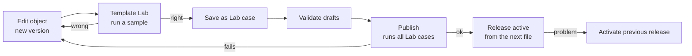

| Item | Value |
|---|---|
| Document | DxMed Operations Guide, release 1.0 |
| Audience | Operators, configurators and administrators |
| Read with | `DxMed_HLD.md`, `DxMed_LLD.md` |

---

## 1. Prerequisites

| Item | Version | Notes |
|---|---|---|
| Go | 1.26 or later | Builds the four Go binaries. `go.mod` pins toolchain 1.27.2 (security fixes), downloaded automatically |
| Node.js | 22 LTS | Builds and serves the UI (`/opt/homebrew/opt/node@22/bin` on macOS) |
| PostgreSQL | 18 | The **DxPS** cluster on `localhost:5433` (TLS). DxMed only adds roles, schema `med` in database `dxps`, and the test database `dxmed_test` |
| OpenSSL | any | Development certificates |

DxPS code and data are not changed. The scripts use the DxPS helper `env.sh` to start PostgreSQL and to
run the few statements that need the cluster's superuser (create roles and the schema).

## 2. Layout on disk

| Path | Content |
|---|---|
| `~/med-runtime/bin` | `med-engine`, `med-collector`, `med-api`, `medctl` |
| `~/med-runtime/logs` | One JSON log per component; `ui-build.log` |
| `~/med-runtime/run` | pid files |
| `~/med-runtime/in/<source>` | Source directories (sample config: `in/msc`, `in/pgw`) |
| `~/med-runtime/out/<route>` | Output directories (`roaming`, `inbound`, `local`, `mvno`, `data`, `error`, `duplicate`…) |
| `~/med-runtime/pki` | DxMed dev CA (`ca.crt`), server certificate for UI and API |
| `~/med-runtime/secrets.env` | Generated passwords (mode 600). Never share or commit |

## 3. First-time setup

```bash
cd Mediation
scripts/infra-setup.sh      # roles, schema med, dxmed_test, secrets, dev certificates,
                            # migrate, admin user, example configuration (2 streams, released)
scripts/run-all.sh          # build Go + UI, start the four components detached, wait for ports
scripts/status.sh           # pid, port and health of each component
```

`infra-setup.sh` is idempotent: running it again keeps existing passwords and objects.

**First login.** Open `https://localhost:8090` and sign in as `admin`. The password is the value of
`MED_ADMIN_PASSWORD` in `~/med-runtime/secrets.env`. Trust `~/med-runtime/pki/ca.crt` in your browser or
keychain to avoid the certificate warning. Change the password under **My account**, then create personal
users under **Users** with the roles they need.

| Role | Can |
|---|---|
| viewer | See everything except users and audit |
| operator | + reprocess / hold / release / cancel files, re-drive, close partials, acknowledge alarms |
| configurator | + edit configuration, run Template Lab, save Lab cases, validate |
| publisher | + publish and activate releases, read the audit trail |
| admin | + users, settings, forced publish |

## 4. Start, stop, status

```bash
scripts/run-all.sh             # build and start (use --no-build to start only)
scripts/stop.sh                # SIGTERM, SIGKILL after 15 s; PostgreSQL is left running (shared with DxPS)
scripts/status.sh
```

| Component | Listener | Health |
|---|---|---|
| med-ui | `https://localhost:8090` | login page |
| med-api | `https://localhost:8543` | `GET /healthz`, `GET /readyz` (checks the database) |
| med-engine | metrics `127.0.0.1:9301/metrics` | worker heartbeat on the Workers page |
| med-collector | metrics `127.0.0.1:9302/metrics` | worker heartbeat |

You can run more than one engine (for example on another host with the same database); files are leased, so
no file is processed twice, and only one engine acts as scheduler at a time.

## 5. Daily operations

### 5.1 Feeding files

Network elements (or an `sftp`/`rsync` job) place files in the stream's source directory. The collector
registers a file when it matches the stream's `pattern` and has not changed for `stable_for` (or when its
`done_suffix` marker exists). Hidden files are ignored. To generate sample files:

```bash
medctl gen msc --dir ~/med-runtime/in/msc --files 3 --records 500 --dups 5
medctl gen pgw --dir ~/med-runtime/in/pgw --files 3 --records 50
```

### 5.2 Watching

- **Dashboard:** totals of the last 24 hours, files by status, queue and pending partials per stream, workers.
- **Files:** filter by stream, status, name. Counters `in / out / err / dup` per file.
- **File detail:** status, reconciliation counters, history (every state change with actor), statistics per
  stage, call type, action and reason, output files, first rejected records.
- **Alarms:** `queue_depth` (backlog over the limit), `dead_files` (files need attention), `seq_gap` (missing
  sequence numbers from an exchange). Acknowledge once handled; alarms clear themselves when the condition ends.
- **Logs:** filter by level, component, stream and text; **live tail** streams new lines.

### 5.3 Handling problems

| Situation | What to do |
|---|---|
| File `FAILED` | It is retried automatically with back-off (30 s × attempt, max 15 min). Check the error on the file page |
| File `DEAD` | Retries exhausted or a rule with flow `error` fired. Fix the cause (configuration or file), then **reprocess** the file or **re-drive** the stream |
| File `DUPLICATE` | The file page links to the original. Reprocess only if it is really new data |
| Rejected records | **Rejected records** page: reason, detail and raw bytes in hex. Fix the template/rules, publish, then reprocess the file |
| Wrong routing after a config change | **Streams & releases** → activate the previous release, then reprocess the affected files |
| Partials waiting too long | **Partials** page: close selected groups; they go through stage UNCOL rules |
| Pause a file | **hold** (from NEW or FAILED), later **release** |

### 5.4 Reports

**Reports** → `volume` (per day and stream with reconciliation), `routes` (records and files per route),
`reasons` (per stage, action and reason). Choose stream and dates, then **Download CSV**.

## 6. Changing configuration



1. **Configuration objects** → choose the kind → open an object, or **Copy from template** to start from an
   existing one. Each save creates a new version; the version list on the right can load any older version.
2. **Template Lab** → choose the stream, upload a sample file, keep *close open partials* checked for merge
   streams, **Run**. Check counts (they must reconcile), routes, rejects, rule trace and output previews.
3. Save the run as a **Lab case**. Every publish of the stream re-runs its cases and refuses to publish if a
   result changes. Re-save the case when the change is intended.
4. **Streams & releases** → **Validate drafts**, then **Publish** with a note. Problems and failing cases are
   listed. Admins can tick *ignore failing lab cases* in an emergency; the audit trail records it.
5. The engine uses the new release from the next file on. Each file records the release it used.

## 7. Command line (`medctl`)

| Command | Purpose |
|---|---|
| `medctl migrate` | Apply schema migrations (as `med_owner`) |
| `medctl bootstrap --admin NAME` | Create the first administrator (password from `MED_ADMIN_PASSWORD`) |
| `medctl seed --root DIR` | Load and publish the example configuration with paths under `DIR` |
| `medctl publish STREAM [--note T] [--force]` | Validate, run Lab cases, publish |
| `medctl user add NAME --roles R1,R2` | Add a user (password from `MED_USER_PASSWORD`) |
| `medctl gen msc\|pgw --dir DIR [--files N] [--records N] [--start SEQ] [--dups N]` | Write sample CDR files (`--dups`: duplicate records per MSC file) |
| `medctl partitions [--days N]` | Create daily partitions ahead |
| `medctl status` | File counts per status and active releases |

`scripts/env.sh` provides `med_env app|owner|ops`, which sets the database connection for a role from the
secrets file without printing it.

## 8. Environment variables

| Variable | Default | Used by |
|---|---|---|
| `MED_DB_HOST`, `MED_DB_PORT`, `MED_DB_NAME`, `MED_DB_USER`, `MED_DB_PASSWORD`, `MED_DB_CA` | `localhost`, `5433`, `dxps`, `med_<role>`, from secrets, DxPS CA | all Go components (exported by `med_env`) |
| `MED_PG_DB` | `dxps` | scripts: target database |
| `DXPS_SCRIPTS` | `~/DxPS/dxps/scripts` | scripts: location of the DxPS helpers |
| `MED_WORKERS` | 4 | engine |
| `MED_LEASE_TTL` | 5m | engine |
| `MED_POLL` | 1s | engine (idle poll, post-action runner) |
| `MED_TICK_EVERY` | 10s | engine scheduler |
| `MED_SCAN_EVERY` | 2s | collector |
| `MED_BEAT_EVERY` | 15s | all (worker heartbeat) |
| `MED_METRICS_ADDR` | `127.0.0.1:9301` / `:9302` | engine / collector |
| `MED_LOG_LEVEL` | `info` | all |
| `MED_LOG_NOMASK` | unset | set to `1` to log identities unmasked (not for production) |
| `MED_API_ADDR` | `127.0.0.1:8543` | api |
| `MED_TLS_CERT`, `MED_TLS_KEY` | from `~/med-runtime/pki` | api |
| `MED_SESSION_TTL` | 8h | api |
| `MED_TRUST_PROXY` | unset | api: use `X-Forwarded-For` for the client IP |
| `MED_UI_CERT`, `MED_UI_KEY`, `MED_UI_PORT`, `MED_UI_HOST` | pki, `8090`, `127.0.0.1` | ui |
| `MED_API_URL`, `MED_API_CA` | `https://localhost:8543`, pki CA | ui |

## 9. Testing and security checks

```bash
scripts/test-all.sh     # go vet, go test -race, coverage gates, UI typecheck and tests with coverage
scripts/sec-scan.sh     # govulncheck, go vet, npm audit, secret patterns in tracked files
```

Reports: `coverage/go.html`, `coverage/go-summary.txt`, `ui/coverage/index.html`. Database tests use the
throw-away database `dxmed_test`, never `dxps`.

## 10. Troubleshooting

| Symptom | Cause and fix |
|---|---|
| `migration 001_schema.sql was changed after it was applied` | A migration file was edited after it ran. Add a new migration instead. On a development machine `scripts/reset-db.sh --yes` rebuilds schema `med` (all DxMed data is lost; DxPS tables are untouched) |
| A page shows `internal error` | The API log `~/med-runtime/logs/med-api.log` has the `request failed` line with the cause |
| Component does not start: address in use | Another process holds the port: `lsof -nP -iTCP:<port> -sTCP:LISTEN`, stop it, then `run-all.sh --no-build` |
| Files stay `NEW` | No engine running, the stream is disabled, or it has no active release (Streams page) |
| Files are not collected | Name does not match the stream pattern, file still growing (`stable_for`), or hidden file |
| Browser certificate warning | Trust `~/med-runtime/pki/ca.crt` |
| Login refused with 429 | 5 failed attempts within 5 minutes for this user and address; wait 5 minutes |

## 11. Building the documents

```bash
scripts/build-docs.sh   # Markdown → diagrams (PNG) → Word (.docx) and PDF in docs/
```

It needs `pandoc`, Google Chrome (for diagrams and PDF) and a local mermaid-cli in
`~/med-runtime/tools/mmdc` (the script installs it on first use).
