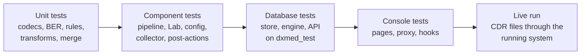
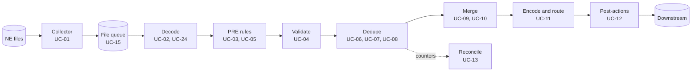

| Item | Value |
|---|---|
| Document | DxMed Test Cases, Use Cases and Results, release 1.0 |
| Code under test | DxMed `d690e42` (16 October 2026) |
| Test run | 17 October 2026, 09:00-09:30 UTC, unattended |
| Environment | macOS 26.6.2 (Apple silicon), Go 1.27.2, Node.js 22.23.2, PostgreSQL 18 (DxPS cluster, TLS) |
| Read with | `DxMed_HLD.md`, `DxMed_LLD.md`, `DxMed_Operations_Guide.md` |

---

## 1. Summary

All automated tests passed and the live system processed every file it was given, with balanced counters. One defect was found in the live run (DEF-01, a false sequence-gap alarm when files of the same exchange are processed in parallel).

| Area | Tests | Passed | Failed | Coverage |
|---|---|---|---|---|
| Go back end (26 packages) | 160 | 160 | 0 | 97.2 % statements (gate 95 %; engine packages 100 %) |
| Console UI (6 suites) | 57 | 57 | 0 | 99.84 % lines, 98.43 % branches (gate 90 %) |
| Use cases | 24 | 24 | 0 | 15 run live, 9 by automated tests only |
| **Total test cases** | **217** | **217** | **0** | |

| Live run | Result |
|---|---|
| Files processed | 5 new (3 MSC, 2 PGW), all POSTED on the first attempt |
| Records | 1,615 in; 1,050 out; 300 errors; 153 dropped; 100 held; 12 duplicates |
| Reconciliation | Balanced for every file |
| Output files | 18 data files and 6 checksum files on 6 routes; checksums verified |
| Alarms | 1 open (seq_gap), see DEF-01 |
| Defects | 1 (DEF-01, minor) |

## 2. Test approach

Tests run at five levels. The engine packages (decoding, rules, transforms, merge, encoding, pipeline) are pure functions tested to 100 % statement coverage. Components that use PostgreSQL run against the throw-away database `dxmed_test`, never the live schema. The console is tested with Vitest and Testing Library. Finally the running system was fed generated CDR files and its database and output files were inspected.



| Level | What | Tool | Where |
|---|---|---|---|
| Unit | Codecs, BER reader, decoders, encoders, rules, transforms, lookups, validation, merge | `go test` | in memory |
| Component | Pipeline end to end, Template Lab, configuration compile, collector, post-actions | `go test` | in memory, temp directories |
| Database | Store, engine with workers, API, medctl, services | `go test` | PostgreSQL `dxmed_test` |
| Console | Pages, BFF proxy, hooks, role gating | Vitest + Testing Library | jsdom |
| Live | CDR files through collector, engine, post-actions | medctl, SQL, file checks | running DxMed |
| Robustness | Fuzzing of BER reader, codecs and decoder | Go fuzzing (seed corpus) | in memory |

The flow below shows the processing path that the use cases follow, and the test areas that cover each step.



## 3. Use cases

Each use case lists the test cases that prove it (identifiers from sections 6 and 7) and what was seen in the live run. "Pass (automated)" means the use case was not run against the live system during the unattended run, but is fully exercised by the automated tests.

| ID | Use case | Live | Status |
|---|------------|--|-----|
| UC-01 | Collect a CDR file from a network element | Yes | Pass |
| UC-02 | Decode Ericsson MSC BER records | Yes | Pass |
| UC-03 | Classify and route voice calls | Yes | Pass |
| UC-04 | Validate records and reject bad ones | Yes | Pass |
| UC-05 | Drop calls that must not be billed | Yes | Pass |
| UC-06 | Remove duplicate records | Yes | Pass |
| UC-07 | Reject a duplicate file | No | Pass (automated) |
| UC-08 | Detect missing files from an exchange | Yes | Pass with defect DEF-01 |
| UC-09 | Merge partial data sessions (PGW) | Yes | Pass |
| UC-10 | Expire incomplete sessions | No | Pass (automated) |
| UC-11 | Write output files for downstream systems | Yes | Pass |
| UC-12 | Run post-actions on outputs | Yes | Pass |
| UC-13 | Reconcile every file | Yes | Pass |
| UC-14 | Recover from failures | No | Pass (automated) |
| UC-15 | Process files in parallel safely | Yes | Pass |
| UC-16 | Operator handles a file | No | Pass (automated) |
| UC-17 | Change configuration safely | Yes | Pass |
| UC-18 | Dry-run a template in the Template Lab | No | Pass (automated) |
| UC-19 | Sign in and access control | No | Pass (automated) |
| UC-20 | Monitor the platform | Yes | Pass |
| UC-21 | Protect subscriber data in logs | No | Pass (automated) |
| UC-22 | Keep the database within limits | No | Pass (automated) |
| UC-23 | Operate from the command line | Yes | Pass |
| UC-24 | Resist malformed input | No | Pass (automated) |

### UC-01 Collect a CDR file from a network element

| | |
|--|----------|
| Actor | Network element / collector |
| Goal | A file placed in a stream source directory is registered once it is complete. |
| Precondition | Stream active; source directory configured. |
| Main flow | NE writes the file; collector scans every interval; file is stable for stable_for (or the done marker exists); file is hashed and registered as NEW. |
| Expected result | Only complete, matching files are registered, once; temporary, hidden and growing files wait. |
| Test cases | TC-COL-01, TC-COL-02, TC-COL-03, TC-COL-04, TC-COL-05 |
| Live evidence | 5 files dropped at 09:19:15 UTC were registered as NEW within 1 second (file history: collector, collected from ~/med-runtime/in/msc/...). |
| Status | **Pass** |

### UC-02 Decode Ericsson MSC BER records

| | |
|--|----------|
| Actor | med-engine |
| Goal | Every BER record of an MSC file is decoded into fields according to the decoding template. |
| Precondition | Decoding template ERICSSON_MSC published. |
| Main flow | Engine leases the file; BER TLVs are read; template maps tags to fields with codecs (TBCD, BCD, TIME_BCD...). |
| Expected result | Fields decoded correctly; unknown tags skipped or reported; structural errors become error records, not file failures. |
| Test cases | TC-DEC-01, TC-DEC-02, TC-DEC-03, TC-BER-02, TC-BER-04, TC-DTY-03, TC-DTY-11, TC-PIP-07 |
| Live evidence | 3 MSC files x 505 records decoded (records_in = 505 each). |
| Status | **Pass** |

### UC-03 Classify and route voice calls

| | |
|--|----------|
| Actor | med-engine (PRE rules) |
| Goal | Each call is routed by business rules: local, outgoing roaming, inbound roaming, MVNO. |
| Precondition | Rule set MSC_RULES and routes L, R, I, MVNO published. |
| Main flow | PRE rules evaluate IMSI, MSC and number ranges with lookups; record gets an action and reason; MULTI actions copy the record to several routes. |
| Expected result | Per 505-record file: LOCAL 150, ROAM_OUT 50, ROAM_IN 50, MVNO 50, MVNO_MT 50 (to MVNO and L). |
| Test cases | TC-FLT-03, TC-FLT-06, TC-LKP-01, TC-RTE-02, TC-PIP-01, TC-PIP-10 |
| Live evidence | Live per file: L 200 records (150 LOCAL + 50 MVNO_MT), R 50, I 50, MVNO 100 (MVNO_ALPHA 50, MVNO_BETA 50). |
| Status | **Pass** |

### UC-04 Validate records and reject bad ones

| | |
|--|----------|
| Actor | med-engine (VALIDATE) |
| Goal | Records that break the field dictionary or are abnormal go to the error route with a reason. |
| Precondition | Field dictionary MSC_DICT; error route ERR. |
| Main flow | Dictionary checks regex, kind, range and age; PRE rules flag abnormal termination; rejected records are written to the error file with reason and detail. |
| Expected result | Bad IMSI gives VALIDATION:REGEX; abnormal cause gives ABNORMAL_TERM; error file lists seq, reason and detail. |
| Test cases | TC-VAL-01, TC-PIP-08, TC-PIP-09 |
| Live evidence | Live per file: 100 errors (50 VALIDATION:REGEX, e.g. served_imsi "4167" does not match ^[0-9]{14,15}$; 50 ABNORMAL_TERM). |
| Status | **Pass** |

### UC-05 Drop calls that must not be billed

| | |
|--|----------|
| Actor | med-engine (PRE rules) |
| Goal | Zero-duration calls are dropped and counted, not lost. |
| Precondition | Rule ZERO_DUR in MSC_RULES. |
| Main flow | PRE rule matches duration 0; action DROP with reason ZERO_DUR. |
| Expected result | Dropped records are counted in records_drop and statistics. |
| Test cases | TC-FLT-03, TC-PIP-01 |
| Live evidence | Live per file: 51 dropped, reason ZERO_DUR. |
| Status | **Pass** |

### UC-06 Remove duplicate records

| | |
|--|----------|
| Actor | med-engine (DEDUPE) |
| Goal | A record seen before (same key, in the file or in earlier files) is not billed twice. |
| Precondition | Record key configured; record_key table holds keys of committed records. |
| Main flow | Each good record's key is checked in the file and against stored keys; duplicates go to the DUP route. |
| Expected result | Duplicates are written to the duplicate file with DUP_RECORD and never reach billing routes. |
| Test cases | TC-DDP-01, TC-PIP-01, TC-STO-10, TC-ENG-01 |
| Live evidence | Live per file: 4 DUP_RECORD records written to out/duplicate and excluded from the billing routes. |
| Status | **Pass** |

### UC-07 Reject a duplicate file

| | |
|--|----------|
| Actor | med-engine (file policy) |
| Goal | A file already processed (same name, checksum, sequence or time range) is marked DUPLICATE. |
| Precondition | Stream dedupe policy enabled. |
| Main flow | Engine compares the file with prior files of the same exchange before commit. |
| Expected result | Status DUPLICATE with the reason and a link to the original; no output. |
| Test cases | TC-DDP-02, TC-ENG-01, TC-STO-07 |
| Live evidence | Not run live: injecting a copied file was blocked by the unattended-run safety review. Covered by the automated tests (DUP_CHECKSUM, DUP_SEQ_RANGE). |
| Status | **Pass (automated)** |

### UC-08 Detect missing files from an exchange

| | |
|--|----------|
| Actor | med-engine / alarms |
| Goal | A jump in the exchange sequence numbers raises a seq_gap alarm. |
| Precondition | Gap check enabled for the stream. |
| Main flow | Engine reads the highest committed sequence of the exchange; if the new file starts beyond it, an alarm is raised. |
| Expected result | Alarm seq_gap with the missing range. |
| Test cases | TC-DDP-02, TC-ENG-01, TC-STO-13 |
| Live evidence | Live: real gap 1501-4500000 detected for MSC01_009001. A second, false gap was reported for MSC01_009003 and replaced the real alarm text (see DEF-01). |
| Status | **Pass with defect DEF-01** |

### UC-09 Merge partial data sessions (PGW)

| | |
|--|----------|
| Actor | med-engine (MERGE) |
| Goal | Partial PGW records of one session are held, merged when complete and routed. |
| Precondition | Merge profile GPRS_PARTIALS (relate charging_id + pgw_address, end on cause 0). |
| Main flow | Partials are held in partial_record; the closing partial completes the group; SUM/LAST/COUNT rules collapse it; COL rules route DATA or DROAM. |
| Expected result | Complete sessions produce one merged record; incomplete ones wait. |
| Test cases | TC-MRG-01, TC-MRG-02, TC-PIP-03, TC-ENG-02, TC-STO-11, TC-API-05 |
| Live evidence | Live: PGW01_000001-000003 merged 50 sessions into DATA 40 and DROAM 10. Files PGW01_009001-009002 (parts 1 and 2) hold 50 groups of 2 partials, waiting for part 3. |
| Status | **Pass** |

### UC-10 Expire incomplete sessions

| | |
|--|----------|
| Actor | med-engine scheduler (leader) |
| Goal | Groups that never complete are released at close time, TTL or partial limit. |
| Precondition | Merge profile ttl 6h, close_times 00:00, max_partials 100, on_expiry uncol. |
| Main flow | Leader scheduler checks pending groups; expired groups are flushed through UNCOL rules. |
| Expected result | Expired groups leave partial_record and are output or dropped as configured. |
| Test cases | TC-MRG-04, TC-PIP-04, TC-ENG-02, TC-LAB-03 |
| Live evidence | Live: 50 groups open since 09:19 UTC; release expected by TTL at about 15:19 UTC (or at the 00:00 close time). Covered by automated tests. |
| Status | **Pass (automated)** |

### UC-11 Write output files for downstream systems

| | |
|--|----------|
| Actor | med-engine / encoders |
| Goal | Each route writes its own file format with naming, header and trailer. |
| Precondition | Output templates CDR_CSV, MVNO_JSONL, ERR_CSV, DATA_CSV. |
| Main flow | Records are encoded per route; files are named from the naming pattern; header and trailer carry counts and totals; files become visible atomically. |
| Expected result | Correct format and naming; trailer count equals the records in the file. |
| Test cases | TC-ENC-01, TC-ENC-02, TC-ENC-04, TC-RTE-03, TC-PIP-02 |
| Live evidence | Live: LOC file starts H/MSC_ERICSSON/L/MSC01_009002.ber and ends T/200/32400/...; MVNO as JSON lines; error file as CSV with reason columns. |
| Status | **Pass** |

### UC-12 Run post-actions on outputs

| | |
|--|----------|
| Actor | post-action runner |
| Goal | After outputs are visible, configured post-actions (checksum, gzip, copy, move, delete) run in order and are retried. |
| Precondition | Routes L and R have post_actions checksum. |
| Main flow | Jobs are queued at commit, run after visibility, retried with back-off and marked dead when exhausted. |
| Expected result | A .sha256 file is written next to each L and R output; file status becomes POSTED. |
| Test cases | TC-PST-01, TC-PST-02, TC-PST-04, TC-STO-17 |
| Live evidence | Live: .sha256 written for the 3 LOC and 3 ROAM files; shasum -a 256 -c verified OK; all files POSTED about 9 s after commit. |
| Status | **Pass** |

### UC-13 Reconcile every file

| | |
|--|----------|
| Actor | med-engine / store |
| Goal | For each file, records in equal records out + error + dropped + held + duplicate. |
| Precondition | None. |
| Main flow | Engine counts outcomes per stage, action and reason and commits them with the file. |
| Expected result | Balanced counters on every file; statistics by stage and reason. |
| Test cases | TC-PIP-01, TC-LAB-01, TC-STO-10 |
| Live evidence | Live: every MSC file 505 = 350 + 100 + 51 + 0 + 4; every PGW file 50 = 50 held. |
| Status | **Pass** |

### UC-14 Recover from failures

| | |
|--|----------|
| Actor | med-engine |
| Goal | IO, decode and changed-file failures are retried with back-off, then marked DEAD with an alarm; outputs are recovered after a crash. |
| Precondition | max_attempts 5; back-off 30 s x attempt, max 15 min. |
| Main flow | Engine fails the file with a code; retries; after the last attempt the file is DEAD and dead_files alarm is raised; Recover fixes half-written outputs. |
| Expected result | Correct error codes; DEAD after retries; alarm clears when handled; no lost or duplicated outputs. |
| Test cases | TC-ENG-03, TC-ENG-04, TC-STO-07 |
| Live evidence | Not run live (requires injecting a corrupt file, blocked by the unattended-run safety review). Covered by the automated tests. |
| Status | **Pass (automated)** |

### UC-15 Process files in parallel safely

| | |
|--|----------|
| Actor | med-engine workers |
| Goal | Several workers process files at the same time without processing a file twice. |
| Precondition | 3 workers. |
| Main flow | Workers lease files from the database queue and send heartbeats; expired leases are reset. |
| Expected result | Each file is leased by exactly one worker. |
| Test cases | TC-STO-08, TC-STO-07, TC-STO-15 |
| Live evidence | Live: the 5 files were processed in parallel within the same second, each exactly once (attempts = 1). |
| Status | **Pass** |

### UC-16 Operator handles a file

| | |
|--|----------|
| Actor | Operator (console or API) |
| Goal | An operator can hold, release, cancel, reprocess a file or re-drive a stream. |
| Precondition | Operator role. |
| Main flow | Operator opens the file page and applies an action; history records the actor. |
| Expected result | Status changes as requested; viewers cannot act. |
| Test cases | TC-STO-09, TC-API-04, TC-UI-32, TC-UI-33 |
| Live evidence | Not run live (no console sign-in during the unattended run). Covered by API and UI tests. |
| Status | **Pass (automated)** |

### UC-17 Change configuration safely

| | |
|--|----------|
| Actor | Configurator / publisher |
| Goal | Configuration objects are edited with optimistic locking, validated, tested in the Template Lab and published as a release; a release can be rolled back. |
| Precondition | Configurator and publisher roles. |
| Main flow | Edit object (If-Match ETag); validate stream; run Lab cases; publish (blocked by failing Lab cases unless forced; publishers cannot force); activate a previous release. |
| Expected result | Stale edits rejected (412); invalid drafts rejected (422); releases numbered; rollback restores the previous release. |
| Test cases | TC-API-02, TC-API-03, TC-OPS-01, TC-STO-06, TC-CFG-04, TC-UI-10, TC-UI-14 |
| Live evidence | Live: active releases MSC_ERICSSON #1 and PGW_DATA #1 (published by medctl seed). |
| Status | **Pass** |

### UC-18 Dry-run a template in the Template Lab

| | |
|--|----------|
| Actor | Configurator |
| Goal | Sample data is run through the stream without writing outputs, showing routes, samples, rejects and reconciliation. |
| Precondition | Configurator role. |
| Main flow | Choose stream and sample; run; compare with saved expected results. |
| Expected result | Balanced result; differences reported; oversize samples refused. |
| Test cases | TC-LAB-01, TC-LAB-02, TC-LAB-03, TC-UI-17 |
| Live evidence | Not run live. Covered by Lab, API and UI tests. |
| Status | **Pass (automated)** |

### UC-19 Sign in and access control

| | |
|--|----------|
| Actor | All users |
| Goal | Users sign in with strong passwords; roles limit what they can see and do; brute force is slowed. |
| Precondition | Users created by an admin. |
| Main flow | Login; session token in HttpOnly cookie; every change needs the CSRF header; five failed logins lock the user temporarily. |
| Expected result | Wrong password and locked users are refused (429 with Retry-After); viewers get 403 on changes; password change ends other sessions. |
| Test cases | TC-AUTH-01, TC-AUTH-02, TC-AUTH-03, TC-API-01, TC-STO-14, TC-UI-41, TC-UI-42, TC-UI-06 |
| Live evidence | Not run live (passwords are not read during an unattended run). Covered by API and UI tests. |
| Status | **Pass (automated)** |

### UC-20 Monitor the platform

| | |
|--|----------|
| Actor | Operator |
| Goal | Dashboard, files, alarms, logs (live tail) and reports show what is happening. |
| Precondition | Viewer role or higher. |
| Main flow | Open dashboard; filter files; acknowledge alarms; tail logs; download volume, route and reason reports as CSV. |
| Expected result | Correct totals; alarms acknowledged; logs stream live; CSV export works. |
| Test cases | TC-API-04, TC-API-06, TC-OBS-05, TC-UI-27, TC-UI-39, TC-UI-01, TC-UI-03 |
| Live evidence | Live (medctl status): last 24 h files=11 in=3280 out=2100 err=600 drop=306 held=250 dup=24; alarms open 1; workers 3. |
| Status | **Pass** |

### UC-21 Protect subscriber data in logs

| | |
|--|----------|
| Actor | All components |
| Goal | IMSI and MSISDN values are masked in logs. |
| Precondition | None. |
| Main flow | Logger masks identifier attributes before writing. |
| Expected result | Logs show 416770******321 style values. |
| Test cases | TC-OBS-01, TC-OBS-02 |
| Live evidence | Covered by automated tests. |
| Status | **Pass (automated)** |

### UC-22 Keep the database within limits

| | |
|--|----------|
| Actor | med-engine scheduler |
| Goal | Daily partitions are created ahead and old data is removed after the retention period. |
| Precondition | Retention setting (default 840 h). |
| Main flow | Scheduler ensures partitions; retention drops old event_log and record_key data. |
| Expected result | Partitions exist ahead; old rows removed. |
| Test cases | TC-STO-16, TC-CFG-01, TC-CTL-01 |
| Live evidence | Covered by automated tests. |
| Status | **Pass (automated)** |

### UC-23 Operate from the command line

| | |
|--|----------|
| Actor | Administrator |
| Goal | medctl migrates, bootstraps, seeds, publishes, adds users, generates sample files and shows status. |
| Precondition | Database roles exist. |
| Main flow | Run medctl commands. |
| Expected result | Commands succeed; wrong flags fail with exit code 1. |
| Test cases | TC-CTL-01, TC-SMP-02 |
| Live evidence | Live: medctl gen msc (3 files x 500 records, 5 duplicates) and gen pgw (2 files x 50 records); medctl status. |
| Status | **Pass** |

### UC-24 Resist malformed input

| | |
|--|----------|
| Actor | Decoders |
| Goal | Random or hostile bytes never crash the decoders. |
| Precondition | None. |
| Main flow | Fuzz tests feed arbitrary bytes to the BER reader, the codecs and the compiled MSC decoder. |
| Expected result | No panic; parsers never read past the buffer. |
| Test cases | TC-BER-06, TC-DTY-18, TC-DEC-11, TC-BER-05 |
| Live evidence | Covered by automated tests (seed corpus). |
| Status | **Pass (automated)** |

## 4. Live run

The running DxMed (med-engine, med-collector, med-api and the console, 3 workers) was fed sample files with `medctl gen`. Results were read from the `med` schema as `med_app` (read only) and from the output directories.

### 4.1 Steps

| Step | Action | Result |
|---|---|---|
| 1 | `scripts/status.sh` | All 4 components listening; 6 files POSTED from the earlier run; 0 alarms |
| 2 | `medctl gen msc --dir ~/med-runtime/in/msc --files 3 --records 500 --dups 5 --start 9001` | MSC01_009001-009003.ber, 42,187 bytes each |
| 3 | `medctl gen pgw --dir ~/med-runtime/in/pgw --files 2 --records 50 --start 9001` | PGW01_009001-009002.ber, 4,100 bytes each |
| 4 | Wait about 90 s; `scripts/status.sh` | 11 files POSTED; 1 alarm open |
| 5 | Query `med.file`, `med.file_event`, `med.file_stat`, `med.output_file`, `med.alarm`, `med.partial_record` | Tables in 4.2 to 4.5 |
| 6 | Inspect `~/med-runtime/out/*`; `shasum -a 256 -c` on a checksum file | 24 new files; checksum OK |

### 4.2 Per-file reconciliation

| File | Stream | Status | Attempts | In | Out | Err | Drop | Held | Dup | Processing time |
|---|---|---|---|---|---|---|---|---|---|---|
| MSC01_009001.ber | MSC_ERICSSON | POSTED | 1 | 505 | 350 | 100 | 51 | 0 | 4 | 36 ms |
| MSC01_009002.ber | MSC_ERICSSON | POSTED | 1 | 505 | 350 | 100 | 51 | 0 | 4 | 16 ms |
| MSC01_009003.ber | MSC_ERICSSON | POSTED | 1 | 505 | 350 | 100 | 51 | 0 | 4 | 16 ms |
| PGW01_009001.ber | PGW_DATA | POSTED | 1 | 50 | 0 | 0 | 0 | 50 | 0 | 4 ms |
| PGW01_009002.ber | PGW_DATA | POSTED | 1 | 50 | 0 | 0 | 0 | 50 | 0 | 10 ms |

In = Out + Err + Drop + Held + Dup holds for every file (505 = 350 + 100 + 51 + 0 + 4; 50 = 50 held).

### 4.3 Outcomes of one MSC file (MSC01_009001.ber)

| Stage | Action | Reason | Records |
|---|---|---|---|
| PRE | L | LOCAL | 150 |
| PRE | R | ROAM_OUT | 50 |
| PRE | I | ROAM_IN | 50 |
| PRE | MVNO | MVNO | 50 |
| PRE | MULTI:MVNO,L | MVNO_MT | 50 |
| PRE | DROP | ZERO_DUR | 51 |
| PRE | ERROR | ABNORMAL_TERM | 50 |
| VALIDATE | ERROR | VALIDATION:REGEX | 50 |
| DEDUPE | DUP | DUP_RECORD | 4 |

| Route | Output file | Records |
|---|---|---|
| L (local) | `LOC_MSC_ERICSSON_20261017021919_000004.csv (+ .sha256)` | 200 |
| R (roaming out) | `ROAM_MSC_ERICSSON_20261017021919_000004.csv (+ .sha256)` | 50 |
| I (inbound roaming) | `INB_MSC_ERICSSON_20261017021919_000004.csv` | 50 |
| MVNO | `MVNO_MSC_ERICSSON_20261017021919_000004.jsonl` | 100 |
| ERR | `ERR_MSC_ERICSSON_MSC01_009001_000004.csv` | 100 |
| DUP | `DUP_MSC_ERICSSON_MSC01_009001_000004.csv` | 4 |

File history:

| Time (UTC-7) | Status | Actor | Detail |
|---|---|---|---|
| 02:19:19.102 | NEW | collector | collected from ~/med-runtime/in/msc/MSC01_009001.ber |
| 02:19:19.780 | LEASED | med-engine worker 3 | attempt 1 |
| 02:19:19.816 | COMMITTED | med-engine worker 3 | in=505 out=350 err=100 drop=51 held=0 dup=4 |
| 02:19:28.791 | POSTED | post-actions | outputs visible, post-actions done |

### 4.4 Sample output records

Local route (CSV with header and trailer):

```text
H|MSC_ERICSSON|L|MSC01_009002.ber|20261017021919
record_type,imsi,msisdn,other_party,msc,lac,ci,start,duration,charged,cause,reason,seq
mtCallRecord,416770000001004,962791200004,962795500004,MSC01,0005,1004,20261017081943,34,60,16,LOCAL,4500505
...
T|200|32400|2026-10-17T08:19:43Z|2026-10-17T09:17:28Z
```

MVNO route (JSON lines):

```json
{"tenant":"MVNO_ALPHA","imsi":"416770000001002","msisdn":"962799000002","other_party":"962795500002","start":"2026-10-17T08:19:29Z","duration":"32","charged":"60","call_type":"1"}
```

Error route:

```text
seq,record_type,reason,errors,imsi,start,file
6,moCallRecord,VALIDATION:REGEX,"served_imsi: REGEX: ""4167"" does not match ^[0-9]{14,15}$",4167,2026-10-17T08:19:50Z,MSC01_009002.ber
7,moCallRecord,ABNORMAL_TERM,,416770000001006,2026-10-17T08:19:57Z,MSC01_009002.ber
```

### 4.5 PGW partials and alarms

| Item | Value |
|---|---|
| Earlier run (PGW01_000001-000003, parts 1-3 of 50 sessions) | 150 partials held, then 50 sessions merged: DATA 40 records, DROAM 10 records |
| This run (PGW01_009001-009002, parts 1-2) | 100 partials held in 50 groups of 2; waiting for part 3, the 6 h TTL or the 00:00 close time |
| Alarm | seq_gap, minor, MSC_ERICSSON: "MSC01: sequence gap 4500501-4501000 before MSC01_009003.ber" |
| Engine log | sequence gap MSC01_009001 from 1501 to 4500000; sequence gap MSC01_009003 from 4500501 to 4501000 |

### 4.6 Not run live

The run was unattended. The safety review blocked three steps: dropping a corrupt file and a byte-identical copy of a file into the input directory, and generating the third PGW part. The behaviours they would have shown (DEAD files, duplicate files, a live merge of new sessions) are covered by the automated tests listed under UC-07, UC-09 and UC-14, and the merge was already shown live by the earlier run. Console sign-in was not used because it needs the generated admin password.

## 5. Defects and observations

| ID | Severity | Title | Status |
|---|---|---|---|
| DEF-01 | Minor | False seq_gap alarm when files of one exchange are processed in parallel; later gap replaces the earlier alarm text | Open |
| OBS-01 | Info | Input files stay in the source directory after processing | By design (no input post-action in the sample configuration) |
| OBS-02 | Info | Go coverage of `internal/engine` is 82.8 % and `internal/store` 92.0 % | Within the gates (overall 95 %; 100 % applies to the engine packages) |

### DEF-01 False sequence-gap alarm under parallel processing

| | |
|--|----------|
| Found in | Live run, use case UC-08 |
| Steps | Generate 3 consecutive MSC files (sequences 4500001-4501500) and drop them together; 3 workers |
| Expected | One seq_gap alarm for the real gap 1501-4500000 (before MSC01_009001) |
| Actual | MSC01_009003 was checked while MSC01_009002 was still being processed, so a gap 4500501-4501000 was reported although MSC01_009002 covers it. Only one seq_gap alarm per stream can be open, and `RaiseAlarm` overwrites its message, so the open alarm now shows the false gap and the real one is only in the engine log |
| Cause | `engine.go` checks gaps against committed files only (`PriorFiles` with status COMMITTED or POSTED); files of the same exchange in flight are not considered. `store.RaiseAlarm` uses ON CONFLICT ... DO UPDATE SET message |
| Impact | Operators may chase a gap that does not exist and miss the real one. No data is lost or duplicated |
| Suggested fix | Re-check the gap after commit (or in the scheduler) against all committed ranges and clear it when filled; keep the earliest open gap or list all gaps in the alarm instead of overwriting |

## 6. Back-end test cases

160 Go test functions in 26 packages, run with `go test -count=1 -p 1` and coverage against `dxmed_test` (`scripts/test-all.sh` adds `-race`). All passed. Time is the test's own run time.

| Package | Tests | Passed | Coverage | Time |
|---|---|---|---|---|
| internal/api | 7 | 7 | 97.7 % | 11.36 s |
| internal/app | 5 | 5 | 98.4 % | 2.32 s |
| internal/auth | 4 | 4 | 96.5 % | 2.39 s |
| internal/ber | 6 | 6 | 100.0 % | 0.34 s |
| internal/collector | 5 | 5 | 98.8 % | 0.33 s |
| internal/config | 8 | 8 | 100.0 % | 0.37 s |
| internal/ctl | 1 | 1 | 96.1 % | 1.94 s |
| internal/datatype | 18 | 18 | 100.0 % | 0.31 s |
| internal/decode | 12 | 12 | 100.0 % | 0.39 s |
| internal/dedupe | 2 | 2 | 100.0 % | 0.34 s |
| internal/encode | 5 | 5 | 100.0 % | 0.34 s |
| internal/engine | 4 | 4 | 82.8 % | 1.97 s |
| internal/filter | 8 | 8 | 100.0 % | 0.34 s |
| internal/lab | 3 | 3 | 100.0 % | 0.44 s |
| internal/lookup | 2 | 2 | 100.0 % | 0.33 s |
| internal/merge | 5 | 5 | 100.0 % | 0.30 s |
| internal/model | 6 | 6 | 100.0 % | 0.49 s |
| internal/obs | 5 | 5 | 100.0 % | 0.40 s |
| internal/ops | 2 | 2 | 96.4 % | 1.05 s |
| internal/pipeline | 13 | 13 | 100.0 % | 0.34 s |
| internal/postaction | 4 | 4 | 97.9 % | 0.39 s |
| internal/route | 3 | 3 | 100.0 % | 0.33 s |
| internal/sample | 3 | 3 | 100.0 % | 0.35 s |
| internal/store | 17 | 17 | 92.0 % | 3.02 s |
| internal/transform | 10 | 10 | 100.0 % | 0.30 s |
| internal/validate | 2 | 2 | 100.0 % | 0.31 s |

### 6.1 Processing engine end to end

#### internal/engine

| ID | Test case | Objective | Steps | Expected result | Result |
|----|-----|---------|---------|---------|----|
| TC-ENG-01 | `TestMSCEndToEnd` | End-to-end MSC file mediation through collector, engine, and post-actions including duplicate and sequence checks. | Seed store and drop a 100-record MSC file with 4 in-file duplicates; drain process and post-actions; assert outputs and file stats; drop checksum-identical, overlapping-seq, and gap files; tick scheduler. | One file processed; roaming/local/error/duplicate CSVs exist with header H/MSC_ERICSSON/R and trailer T/10; committed stats In=104 Out=70 Err=20 Drop=11 Dup=3; DUP_CHECKSUM and DUP_SEQ_RANGE statuses; one seq_gap alarm mentioning 101; second roaming seq _000002. | Pass (0.32 s) |
| TC-ENG-02 | `TestPGWMergeAndExpiry` | PGW partial merge across files, TTL expiry via scheduler, and single-leader election. | Drop three PGW files (parts 1/3, 2/3, 3/3 of 5 sessions), drain each; assert partials then DATA/DROAM outputs; drop incomplete file and tick before/after +7h; tick second holder. | Partials are 5,5,0 after files 1-3; one DATA and one DROAM file with 4 SESSION lines; no early expiry; Expired=3 after 7h and partials cleared; second DATA file appears; other holder is not leader. | Pass (0.34 s) |
| TC-ENG-03 | `TestFailuresAndRecovery` | File failure codes, dead-file alarm lifecycle, and output recovery rename/orphan cleanup. | Remove collected MSC so ProcessNext fails IO; rewrite content for CHANGED; drop undecodable bytes for DECODE; retry until DEAD and alarm; cancel/redrive to clear; corrupt committed outputs and call Recover. | Statuses/codes IO, CHANGED, DECODE; two DEAD files raise dead_files then clear after cancel; Recover returns renamed=1 removed=1, restores path, clears invisible outputs, raises output_lost. | Pass (0.39 s) |
| TC-ENG-04 | `TestRunLoop` | Engine Run loop posts a collected file and default backoff/config values are sane. | Collect a 30-record MSC file; run Engine.Run with 2 workers until StatusPosted or timeout; cancel; check Backoff and New defaults. | File reaches StatusPosted; Backoff(1)=30s and Backoff(100)=15m; empty Config gets Owner set, LeaseTTL=5m, MaxAttempts=5. | Pass (0.36 s) |

#### internal/pipeline

| ID | Test case | Objective | Steps | Expected result | Result |
|----|-----|---------|---------|---------|----|
| TC-PIP-01 | `TestMSCEndToEnd` | MSC sample plan routes, counts, samples, header/trailer body, and cross-file dedupe. | Run 100-record MSC with 3 dups under Trace MaxSamples=12; check counts, routes, range, samples, R body; commit keys; rerun same records as file 2. | In=103 balanced; Dup/Drop/Err match Expect; Out=R+I+L+MVNO; routes R/I/MVNO/L(+10 MULTI)/ERR/DUP match; Range MSC01 1-100; 70 NewKeys and 12 samples; second run Dup equals prior good outs. | Pass (0.00 s) |
| TC-PIP-02 | `TestMSCRolling` | Local route MaxRecords rotation splits L outputs into multiple files. | Set route L Rotation.MaxRecords=15; Run 100-record MSC without in-file dups; count L outputs. | Exactly 3 L output parts (40 local records at 15 per file). | Pass (0.00 s) |
| TC-PIP-03 | `TestPGWMergeAcrossFiles` | Incomplete PGW sessions held across files then merged and routed when complete. | Run parts 1-2 of 10 sessions (Held); commit; run part 3; assert merge deletes and DATA/DROAM bodies. | First: Held=20 Merged=0 10 Upserts no outputs; second: Held=10 Merged=10 10 Deletes; DATA=8 DROAM=2; no groups left; DATA body has summed volume 3000000, duration 1800 and 3 partials. | Pass (0.00 s) |
| TC-PIP-04 | `TestPGWExpiry` | Flush expired partials, late partial after TTL, OnExpiry modes, and Flush guards. | Hold 4 incomplete sessions; Flush at +7h; Run late part 2 at +7h; Flush with OnExpiry drop/error; Flush MSC and empty group. | Expired=4 Deletes=4 DATA=4 with In/Out 0; late run Expired=4; drop yields 0 outputs, error yields 1; Flush without merge profile and empty group error. | Pass (0.00 s) |
| TC-PIP-05 | `TestStateErrors` | Pipeline surfaces KnownKeys/LoadGroups failures, tolerates nil group maps, and fails bad decode. | MSC Run with keyErr; PGW Run with grpErr; PGW Run with nilMaps; Run undecodable 0x1F payload. | keyErr and grpErr fail Run; nilMaps succeeds with Merged=1; decode error fails Run. | Pass (0.00 s) |
| TC-PIP-06 | `TestFileInfoError` | File-name sequence extract fails on bad names and falls back to file regex when SeqField empty. | Run name MSC01.ber with Sequence regex; then Run MSC01_000042.ber with SeqField cleared. | First Run errors; second succeeds with Range SeqFrom/SeqTo=42. | Pass (0.00 s) |
| TC-PIP-07 | `TestDecodeErrorRecord` | A structurally incomplete BER record is counted as a decode error not a file failure. | Run MSC plan on TLV missing required fields. | Err=1 and stats DECODE/ERROR/DECODE:MISSING count 1; Run err is nil. | Pass (0.00 s) |
| TC-PIP-08 | `TestRejects` | Reject samples capture validation failures and MaxRejects caps or disables the list. | Run 30-record MSC; re-run with MaxRejects=2 and MaxRejects=-1. | 6 rejects; first Seq=6 StageValidate with Raw; second Reason ABNORMAL_TERM; two.Rejects=2; none.Rejects=0 but Err still 6. | Pass (0.00 s) |
| TC-PIP-09 | `TestInvalidContinue` | OnInvalid=continue lets regex-invalid records proceed so only abnormal termination errors. | Set Stream.OnInvalid=continue; Run 10 MSC records. | Err=1 only (abnormal termination); counts stay balanced. | Pass (0.00 s) |
| TC-PIP-10 | `TestPreOutcomes` | PRE-stage actions cover transform/rule/dup/hold/no-route/disabled/output/custom reason and default. | Raw MSC plan with PRE conditions for seqs 1-8 (TG_BAD, ERROR, DUP, HOLD, NOWHERE, OFF, remove IMSI, ERROR X); Run 10 records. | Exact reason counts for TRANSFORM RULE DUP NO_MERGE_PROFILE NO_ROUTE:NOWHERE OFF OUTPUT X and NO_RULE=2; DUP route 0; Out=1. | Pass (0.00 s) |
| TC-PIP-11 | `TestFileErrorFlow` | PRE FlowError with ERROR action aborts the whole file via ErrFileRule. | PRE any-match ERROR BAD_FILE FlowError; Run 3-record MSC. | errors.Is(err, ErrFileRule) and r.FileError non-empty. | Pass (0.00 s) |
| TC-PIP-12 | `TestMergeOutcomes` | COL merge failure and post-merge COL rule outcomes for transform, no-rule, hold, and drop. | Add EQU on differing record_seq then Run/Flush; for each COL case run complete single-part sessions. | COL/ERROR/MERGE=2 Held=4; Flush UNCOL/ERROR/MERGE=1; each case reason count 2 with Merged=2 (TRANSFORM, NO_RULE, HOLD_AFTER_MERGE, DROP/TEST). | Pass (0.00 s) |
| TC-PIP-13 | `TestStatsOrdering` | finish sorts Stats by stage then call type then action then reason. | Seed runner stats with five keys; call finish; concatenate Stage+CallType+Action+Reason. | Order is COL1LA PRE0LA PRE1DA PRE1LA PRE1LB. | Pass (0.00 s) |

### 6.2 Collection, post-actions and file handling

#### internal/collector

| ID | Test case | Objective | Steps | Expected result | Result |
|----|-----|---------|---------|---------|----|
| TC-COL-01 | `TestScanStable` | Verifies directory scan waits for StableFor, skips temps/dirs/non-matches, hashes once, and tracks growth/removal. | Writes matching and non-matching files; scans before/after stability; resizes a growing file then lets it stabilize; removes it. | Only stable matching file registers with size/SHA/stream; no double collect; growing file waits; removed path untracked. | Pass (0.00 s) |
| TC-COL-02 | `TestScanDoneMarker` | Verifies Done-suffix marker is required before collecting a file. | Scans with .done configured before and after writing A.ber.done. | Zero files until marker exists, then one collected. | Pass (0.00 s) |
| TC-COL-03 | `TestErrors` | Verifies Scan surfaces release errors, counts per-stream scan errors, and hashFile rejects bad paths. | ActiveReleases error; then missing dir plus RegisterFile error with metrics; hashes missing path and directory. | Release error returned; scan returns n=0 with two ScanError counts; hashFile errors on missing and dirs. | Pass (0.00 s) |
| TC-COL-04 | `TestUnreadableFile` | Verifies an unreadable file is skipped without failing the scan (non-root). | Writes mode 000 file and scans (skips if uid 0). | n=0 and err=nil. | Pass (0.00 s) |
| TC-COL-05 | `TestRun` | Verifies Run keeps scanning on a short interval until context cancel despite release errors. | Starts Run with failing ActiveReleases; waits for at least three scans; cancels. | Loop continues then exits after cancel. | Pass (0.00 s) |

#### internal/postaction

| ID | Test case | Objective | Steps | Expected result | Result |
|----|-----|---------|---------|---------|----|
| TC-PST-01 | `TestOps` | Verifies copy, checksum, gzip, move, delete ops including idempotent retries and unknown op. | Runs copy/checksum/gzip/move/delete on a file; retries gzip/move/delete; copies after source moved; tries zip. | Files/checksums/gzip contents and paths match; retries succeed; unknown op errors. | Pass (0.02 s) |
| TC-PST-02 | `TestErrors` | Verifies ops fail on missing sources, bad destinations, writeAtomic failures, and non-empty dir delete. | Runs ops on missing file; move/writeAtomic into file and read-only paths; atomicFile fill error; hash/gzip dir; delete non-empty dir. | Each case returns an error and fill leaves no temp file. | Pass (0.00 s) |
| TC-PST-03 | `TestCrossDeviceMoveFallback` | Verifies move reports error when rename/copy into destination cannot complete because target path is a directory tree. | Creates src file and dst/a/x directory; moves src into dst. | Do returns a non-nil error. | Pass (0.01 s) |
| TC-PST-04 | `TestRunner` | Verifies Drain runs jobs, records failures, surfaces lease/finish/cancel errors, and Backoff timings. | Drains gzip/bad-JSON/missing jobs; drains empty op; forces lease and finish errors; cancels context; checks Backoff. | Three jobs processed with two OnFailure calls and .gz path; lease/finish/cancel error; Backoff 10s/40s/10m. | Pass (0.01 s) |

#### internal/dedupe

| ID | Test case | Objective | Steps | Expected result | Result |
|----|-----|---------|---------|---------|----|
| TC-DDP-01 | `TestRecordKey` | RecordKey is stable for equal field values, changes when values change, avoids boundary collisions, and Set Add is idempotent. | Key same clone on x,y; change y; compare (12,3) vs (1,23); Set.Add twice. | Keys equal and String length 32; different after change; no boundary collision; first Add true second false. | Pass (0.00 s) |
| TC-DDP-02 | `TestCheckFile` | File policy detects NAME/CHECKSUM/SEQ_RANGE/TIME_RANGE duplicates, gaps, self-skip, disabled policy, and Describe text. | CheckFile seven FileInfo cases against two priors under all-on Policy; empty Policy; Describe three Verdicts. | Reasons NAME CHECKSUM SEQ_RANGE TIME_RANGE then ok with GapFrom 101; self ID not duplicate; empty Policy never Duplicate; Describe strings match. | Pass (0.00 s) |

#### internal/merge

| ID | Test case | Objective | Steps | Expected result | Result |
|----|-----|---------|---------|---------|----|
| TC-MRG-01 | `TestMergeFlow` | Out-of-order partials complete on end cause and Collapse applies SUM/AVG/LAST/FIRST/DIFCNT/USE/VAL rules. | Compile GPRS profile; Add parts seq 2,1 for C1 plus C2; Add seq 3 cause=0; Collapse C1 group. | Not complete until end part; Complete true LastSeen updated; fields duration_s=60 avg=20 end_time/min_end/max_dur/cause/first_cell/cells/partials/has_cell/rat/cell2/flag as asserted; no cell9/missing; Seq=1. | Pass (0.00 s) |
| TC-MRG-02 | `TestBaseLastAndEndAny` | BASE LAST with EndOn=any completes on any matching partial and Desc sort reorders parts. | Compile with LAST BASE, EndOn any, sort record_seq Desc then cell; Collapse four parts. | Complete true; collapsed record_seq=1; Parts[0] cell=A and record_seq=2 after sort. | Pass (0.00 s) |
| TC-MRG-03 | `TestErrors` | Collapse/Complete guards and Compile reject invalid profile options. | Collapse empty; Complete empty; EQU rat mismatch; non-numeric SUM; no EndCondition never Complete; 12 bad Compile mutations. | Empty collapse/complete fail; EQU and SUM error; never complete without end; all listed Compile cases rejected. | Pass (0.00 s) |
| TC-MRG-04 | `TestExpiry` | Expiry by close times in zone, TTL, and MaxPartials with OnExpiry=drop. | Compile with CloseTimes 00:00/12:00 Asia/Amman drop; check Expired around 11:00 and 12:30 and TTL; recompile without close/TTL with 10 parts. | OnExpiry drop; not expired at +1h; expired at +150m and by TTL; MaxPartials expires 10-part group; long TTL alone does not expire small group. | Pass (0.00 s) |
| TC-MRG-05 | `TestEncodeDecode` | Part list gob Encode/Decode round-trips fields and rejects junk or nil records. | Encode part with amount 1.25; Decode; Decode junk; Encode nil record. | Round-trip length 1 amount 1.25 end_time equals t0; junk and nil Encode fail. | Pass (0.00 s) |

#### internal/route

| ID | Test case | Objective | Steps | Expected result | Result |
|----|-----|---------|---------|---------|----|
| TC-RTE-01 | `TestValidate` | Route.Validate accepts good and disabled routes and rolling rotation; rejects bad code/output/dir/naming/rotation/post-actions. | Validate good, disabled DUP, rolling MaxRecords=10; mutate nine bad variants. | Good cases nil error; all bad cases non-nil error. | Pass (0.00 s) |
| TC-RTE-02 | `TestTargets` | Targets parses single codes and MULTI lists ignoring blanks. | Call Targets on R and MULTI:R, L,,. | Returns [R] and [R L]. | Pass (0.00 s) |
| TC-RTE-03 | `TestNaming` | CompileNaming/Render expands tokens with zero-padded seq and rejects unsafe or empty patterns. | Render full token pattern with 2026-10-16 08:30:05 Seq=7; Render ../x; empty stream; CompileNaming bad strings. | Name R_MSC_dir1_EX1_in_01_3_f1_26083005_0007-in_01.ber; unsafe/empty/bad patterns error. | Pass (0.00 s) |

### 6.3 Configuration, Template Lab and publishing

#### internal/config

| ID | Test case | Objective | Steps | Expected result | Result |
|----|-----|---------|---------|---------|----|
| TC-CFG-01 | `TestSamplesCompile` | All sample streams Validate/Compile; retention default 840h; PGW missing record_key is warning only. | Validate+Compile each sample stream; check Hash/Routes/path; MSC Retention 840h with/without Retention string; Validate PGW. | No errors; Hash 64 chars equals Bundle.Hash; path under /srv/med/; Retention Hours=840; PGW one warning at stream.dedupe.record_key. | Pass (0.00 s) |
| TC-CFG-02 | `TestValidateStream` | ValidateStream rejects invalid stream fields and accepts cleared optional defaults. | Mutate twelve bad Stream fields from MSC sample; then set StableFor empty, OnInvalid continue, OnRangeDup records, Retention empty. | Each bad case errors; cleaned case nil error. | Pass (0.00 s) |
| TC-CFG-03 | `TestCompileErrors` | Compile and Validate reject many broken bundle mutations; disabled route may omit output. | For 17 mutations Compile and Validate; then disable route with Output NONE. | Each mutation Compile errors and Validate HasErrors with the bundle path; disabled NONE Output compiles. | Pass (0.01 s) |
| TC-CFG-04 | `TestValidateReferences` | Validate reports bad route/default/HOLD references and treats warnings as non-errors. | Mess MSC default HOLD, MULTI NOWHERE ZZ, dup_route NOPE, clear error_route/record_key; HOLD on PGW COL; HasErrors on warning-only. | Paths/messages match the expected map; COL HOLD only allowed in PRE; warning-only HasErrors false. | Pass (0.00 s) |
| TC-CFG-05 | `TestTransformRefs` | TransformRefs collects unique transform names from rule-set defaults and conditions in order. | Call on RuleSet with A B D refs and empty RuleSet. | Join is A,B,D; empty returns no names. | Pass (0.00 s) |
| TC-CFG-06 | `TestAssembleErrors` | Assemble fails when any required document is missing or garbage JSON for every sample stream. | For each stream document id, Assemble with getter returning gone or { for that doc only. | Every missing/garbage case errors and message contains the document name. | Pass (0.00 s) |
| TC-CFG-07 | `TestNameOf` | NameOf reads route code or stream name and errors on missing fields or bad JSON. | NameOf route with code R; stream name S; route without code; stream {}; bad [. | Returns R and S; errors mention code/name; bad JSON errors. | Pass (0.00 s) |
| TC-CFG-08 | `TestCheckDoc` | CheckDoc accepts all sample docs, rejects bad JSON and invalid kind payloads, and Kinds has nine entries. | CheckDoc each Docs entry and bad [; CheckDoc six invalid kind payloads and unknown widget. | Sample docs ok; bad JSON and invalid/unknown kinds error; len(Kinds)=9. | Pass (0.00 s) |

#### internal/lab

| ID | Test case | Objective | Steps | Expected result | Result |
|----|-----|---------|---------|---------|----|
| TC-LAB-01 | `TestMSC` | Lab Run MSC sample produces balanced routes/samples/rejects; Compare/Gate detect mismatches and oversize samples. | Run 20-record MSC Samples=5; Compare ExpectedOf then mutated Expected; Gate ok/bad/big cases. | Routes R=2 Rejects=4 Samples=5 Balanced; Compare empty then 3 diffs mentioning route R; Gate fails bad and big (over MaxSampleBytes) only. | Pass (0.01 s) |
| TC-LAB-02 | `TestDefaultsAndProblems` | Empty input, invalid bundle, decode failure, and PRE FlowError file abort surface correctly. | Run nil data; clear Stream.Routes; Run 0x1F; PRE FlowError ERROR on any. | Empty In=0 no problems; HasErrors on problems; Error non-empty and Compare reports run failed; FileError set. | Pass (0.00 s) |
| TC-LAB-03 | `TestPGWFlushAndPreview` | PGW pending vs Flush expiry and binary/truncated output preview for large BER encode. | Run incomplete PGW without/with Flush; switch CDR_CSV to ber; Run 5000-record MSC. | Pending=3 then Pending=0 Expired=3 DATA+DROAM=3; some output Binary with Hex and Truncated true. | Pass (0.08 s) |

#### internal/ops

| ID | Test case | Objective | Steps | Expected result | Result |
|----|-----|---------|---------|---------|----|
| TC-OPS-01 | `TestSeedAndPublish` | Verifies Seed create/idempotent/update and Publish gates, force, invalid config, and closed-store errors. | Seeds twice then again with new root; publishes unknown stream; adds failing/broken lab cases and disabled stream; force-publishes; empties routes; closes store. | First seed creates 26 objects and 2 releases; republish is unchanged; lab gate/force/audit/validation/closed-store behave as asserted. | Pass (0.24 s) |
| TC-OPS-02 | `TestPublishErrors` | Verifies Publish/Seed surface privilege failures when DB grants are revoked. | Seeds; revokes SELECT on lab_case, INSERT on release, INSERT on config_object around Publish/Seed calls. | Each revoked privilege causes Publish or Seed to return an error. | Pass (0.27 s) |

#### internal/sample

| ID | Test case | Objective | Steps | Expected result | Result |
|----|-----|---------|---------|---------|----|
| TC-SMP-01 | `TestDocs` | Sample Docs are numerous, placeholder-free, named, sorted, cover all kinds, and Bundle/Pretty work. | Docs(/rt); check Placeholder NameOf sort Kinds; Getter missing; Bundle each Streams; Pretty JSON and non-JSON. | len(docs)>=20; no Placeholder; names match; sorted; every Kind present; missing Getter errors; Bundles ok; Pretty indents a:1 and leaves x. | Pass (0.00 s) |
| TC-SMP-02 | `TestGenerators` | MSC/PGW generators are deterministic with expected outcome counts and duplicate capping. | Build MSC twice; Expect for 20/2 dups; Duplicates=50 length grows; PGW name/build. | Bytes equal, Name MSC01_000007.ber; outcomes sum 20 Dup=2 MVNO=4 L=6; longer with many dups; PGW01_000003.ber non-empty. | Pass (0.00 s) |
| TC-SMP-03 | `TestEncPanics` | enc panics on invalid TBCD input rather than returning quietly. | Call enc TBCD with Str zz under recover. | recover() non-nil. | Pass (0.00 s) |

### 6.4 Decoding, encoding and data types

#### internal/ber

| ID | Test case | Objective | Steps | Expected result | Result |
|----|-----|---------|---------|---------|----|
| TC-BER-01 | `TestTagString` | Verifies Tag.String/ParseTag round-trip, rejection of bad tag strings, and that Key ignores the constructed bit. | Formats Context/Application/Universal/Private tags like [1], APP 2, UNI 16 C, PRIV 300 and parses them back; rejects empty, X 1, [x], oversized APP num; compares Key of context-3 vs constructed context-3. | String and ParseTag match for each case; bad strings error; Keys are equal. | Pass (0.00 s) |
| TC-BER-02 | `TestRoundTrip` | Verifies AppendTLV plus Next/Children round-trip a nested constructed TLV with a large payload. | Builds [1] C containing [1] 01 and [200] with 300 0xAB bytes; Next parses outer; Children walks inner TLVs. | Outer End is full buffer, constructed num 1, Raw equals buf; two children and tag 200 content length 300. | Pass (0.00 s) |
| TC-BER-03 | `TestAppendTagLength` | Verifies AppendTag and AppendLength byte encodings for high tag numbers and long lengths. | Encodes context tags 31 and constructed 200; encodes lengths 0x7F and 0x1234. | Bytes match 9F1F, BF8148, 7F, and 821234. | Pass (0.00 s) |
| TC-BER-04 | `TestIndefinite` | Verifies Next and Children parse nested indefinite-length constructed BER ending with EOC octets. | Parses A1 80 with nested A2 80 and trailing 00 00 fillers; walks children. | Outer Indefinite true End 14; two kids and second is indefinite. | Pass (0.00 s) |
| TC-BER-05 | `TestErrors` | Verifies Next/Children return the correct sentinel errors for truncated, oversized, and illegal BER. | Feeds empty, truncated tags/lengths, tag too big, length too long, indefinite primitive, unterminated indefinite, truncated Children, and nesting past MaxDepth. | errors.Is matches ErrTruncated, ErrTagTooBig, ErrLength, ErrIndefPrim, or ErrDepth as listed. | Pass (0.00 s) |
| TC-BER-06 | `FuzzNext` | Fuzzes Next so a successful parse never reports End past the input buffer. | Seeds an indefinite sample; fuzzes arbitrary bytes through Next. | If err is nil, e.End is not greater than len(b). | Pass (0.00 s) |

#### internal/datatype

| ID | Test case | Objective | Steps | Expected result | Result |
|----|-----|---------|---------|---------|----|
| TC-DTY-01 | `TestRegistry` | Verifies Get rejects unknown codecs and Catalog lists every registered codec sorted by name. | Calls Get(NOPE); compares Catalog length to registry and checks first two names sorted. | Get returns false; catalog length matches and is sorted. | Pass (0.00 s) |
| TC-DTY-02 | `TestPrepare` | Verifies Opts.Prepare resolves Zone to a time.Location and rejects unknown zones. | Checks default UTC; Prepare with empty zone; Asia/Riyadh; Nowhere/City. | Default and empty stay UTC; Riyadh loads; bad zone errors. | Pass (0.00 s) |
| TC-DTY-03 | `TestTBCD` | Verifies TBCD/TBCDR decode and encode with SkipTonNpi, KeepF, and digit alphabet *#ab. | Decodes 1476F7 to 41677, SkipTonNpi 9121F3 to 123, KeepF 21F3 to 123F, BADC to *#ab; encodes 41677 and SkipTonNpi 12; rejects x1/1x. | Decoded strings and encoded bytes match; invalid digits error on encode. | Pass (0.00 s) |
| TC-DTY-04 | `TestBCD` | Verifies BCD/ABCD decode/encode stop at F filler and reject non-decimal nibbles. | Decodes 123F45 and ABCD 1F23 to 123; encodes 123 to 123F; rejects 1A decode and a1/1a encode. | Strings/bytes match; invalid inputs error. | Pass (0.00 s) |
| TC-DTY-05 | `TestBCDS` | Verifies signed BCD decode/encode including C/D sign nibbles and length/digit errors. | Via HEX, checks 012C to 12, 123F to 123, 123D to -123; encodes 12 and -123; rejects empty, 10 bytes, A10C, single byte, and Str(x). | Integer values and bytes match; bad inputs error. | Pass (0.00 s) |
| TC-DTY-06 | `TestHexNum` | Verifies HEX, NUM, and NUMR codecs including Len padding and reverse endian. | HEX ab01 to AB01; NUM 0100 to 256; NUMR 0100 to 1; NUM Len:3 pads 1; NUMR Len:9 encodes 256 as 0001; rejects zz, empty/9-byte NUM, negative INT, bad Str. | Values and bytes match; invalid cases error. | Pass (0.00 s) |
| TC-DTY-07 | `TestINT` | Verifies two's-complement INT decode/encode for positive, negative, and 128 boundary. | Decodes FF to -1 and 0080 to 128; encodes 0,127,128,-1,-129; rejects empty/9-byte and Str(x). | Integers and minimal encodings match; bad inputs error. | Pass (0.00 s) |
| TC-DTY-08 | `TestBITS` | Verifies BITS mask/shift numeric extract and Flags named bitstrings. | With Mask 0x30 Shift 4 on F0 gets 3; Flags A,B,C on 05 gets A and C; encodes A and C to 5 and Uint(3) Shift 4 to 30; rejects empty and Str(x). | U/S and encoded bytes match; errors on bad input. | Pass (0.00 s) |
| TC-DTY-09 | `TestText` | Verifies ASCII, ASCIIS, ASCIIP, and EBCDIC text codecs including pad and printable filter. | ASCII keeps spaces; ASCIIS trims; ASCIIP strips controls; ASCIIS Len4 pads; EBCDIC round-trips Hello World 42?; 00 to ?; rejects ~. | Strings and padded/EBCDIC bytes match; unsupported EBCDIC char errors. | Pass (0.00 s) |
| TC-DTY-10 | `TestIP` | Verifies IPADD for IPv4 bytes, IPv4-mapped IPv6, and ASCII IP with encode/reject. | Decodes 10.0.0.1, mapped 192.168.1.1, trimmed 2001:db8::1; encodes 10.0.0.1; rejects bad ip and Str(x). | Kind KIP and strings match; invalid inputs error. | Pass (0.00 s) |
| TC-DTY-11 | `TestTimeBCD` | Verifies TIME_BCD with +/- offset, zone-only 6-byte form, and invalid calendars/signs. | Round-trips 2026-10-16T08:30:05+03:00 and negative offset; 6-byte with Asia/Riyadh location; rejects short, bad BCD, *, month 13, Str(x). | RFC3339 and bytes match; location Asia/Riyadh; errors on bad input. | Pass (0.00 s) |
| TC-DTY-12 | `TestTimeASC` | Verifies GoLayout mapping and TIME_ASC default/custom layouts. | Checks layout tokens; decodes 20261016083005 and DD/MM/YYYY 16/10/2026; encodes default and YYYY; rejects bad and Str(x). | Times and encoded strings match; bad input errors. | Pass (0.00 s) |
| TC-DTY-13 | `TestTimeUnix` | Verifies TIMEUNX binary and TIMEUNXDEC decimal unix codecs including Len and negative reject. | Decodes 60s from 0000003C and " 60 "; encodes 4- and 8-byte and decimal 60; rejects empty, 8xFF, x, Str(x), negative time. | Unix 60 and bytes/strings match; invalid cases error. | Pass (0.00 s) |
| TC-DTY-14 | `TestDuration` | Verifies UnitOf and DURATION/DURATIONDEC with unit ds and second counts. | UnitOf(ds)=100ms; DURATION 000F ds to 1.5s; DURATIONDEC 90 to 90s; encodes same; rejects unit h length 1, empty, -1, Str(1). | Durations and bytes match; bad unit/input errors. | Pass (0.00 s) |
| TC-DTY-15 | `TestDecimalBoolSet` | Verifies DECIMAL scale, BOOL true/false encodings, and SET fixed-value mapping. | DECIMAL " 1.25 " and Scale2 125; BOOL 1; encodes true/true/1 as FF and false as 0; SET Value MOC; rejects bad decimal/empty bool/Str(x). | Decimal/bool/set values and encodings match; errors on invalid. | Pass (0.00 s) |
| TC-DTY-16 | `TestLookSepRaw` | Verifies LOOK/LOOKS table lookup, SEP list split/join, and RAW defensive copy. | LOOK 16 to normal via cause table else 17; LOOKS " 16 "; Encode LOOK gives ErrNotEncodable; SEP a,b and empty items; RAW copy survives mutation and encodes bytes or Str. | Lookup/list/raw behaviours and ErrNotEncodable hold. | Pass (0.00 s) |
| TC-DTY-17 | `TestRoundTrip` | Verifies selected encodable codecs re-encode their own Decode output to identical bytes. | For TBCD, BCD, HEX, NUM, INT, IPADD, TIMEUNX, DURATION, EBCDIC: Decode then Encode sample inputs. | Out bytes equal original input for each codec. | Pass (0.00 s) |
| TC-DTY-18 | `FuzzDecode` | Fuzzes every Catalog codec Decode against arbitrary bytes for crash freedom. | Seeds TBCD and TIME_BCD samples; runs Decode(Opts{}) for each catalog codec. | No panic for any input (seed corpus run in CI). | Pass (0.00 s) |

#### internal/decode

| ID | Test case | Objective | Steps | Expected result | Result |
|----|-----|---------|---------|---------|----|
| TC-DEC-01 | `TestBER` | Verifies BER template decoding of moCall fields, repeats, IGNORE, unknown skip, and stats. | Builds two moCalls with change/cells/ignore/unknown tags and fillers; compiles MSC template; collects records. | Two records, Skipped 1; fields like served_imsi 41677, change vols 5/6, cells 1,2; Seq 1 then 2. | Pass (0.00 s) |
| TC-DEC-02 | `TestBERErrors` | Verifies UnknownTag=error paths, STRUCTURE/DECODE errors, size/header limits, and emit failure propagation. | Decodes unknown tag/record, truncated structure, 9-byte NUM; MaxRecordSize 4; HeaderLen; emitFails. | Five error records with codes UNKNOWN_TAG, UNKNOWN_RECORD, STRUCTURE, STRUCTURE, DECODE; decode/emit failures as expected. | Pass (0.00 s) |
| TC-DEC-03 | `TestBERWildcardAndBlocks` | Verifies [*] wildcard HEX capture and file BlockSize/BlockHeader/HeaderLen framing. | Adds [*] other; pads two 32-byte blocks after file header; decodes AB other and second Offset. | Two records; other=AB; second Offset=1+32+2. | Pass (0.00 s) |
| TC-DEC-04 | `TestBinBlock` | Verifies fixed/variable bin-block matching, field windows, MISSING, and truncated/filler errors. | Decodes header+block with fixed 01 and var 02; checks a=5 rest=AA MISSING far; b=xyz; probes bad match/fillers/length/emit. | Two records, Errors 1; field values and decode/emit errors as coded. | Pass (0.00 s) |
| TC-DEC-05 | `TestText` | Verifies CSV, FWV, and tagged text formats including match/skip, MISSING, and emit failures. | CSV ; Header Comment; FWV 01ABCDE; tagged CDR with A/B prefixes and END; corrupt CSV and emitFails. | CSV two voice MISSING ZZ; FWV one record Skipped 2; tagged four records Skipped 1; emit errors propagate. | Pass (0.00 s) |
| TC-DEC-06 | `TestJSON` | Verifies JSONL/array JSON path extraction, type coercion, null skip, and DECODE errors. | Matches type=data; paths sub.imsi, roam/home bools, obj JSON, bad vol abc; array with vol 12; truncated JSON; emitFails. | Two records, Skipped 1; first field values; second DECODE; array one record; errors as expected. | Pass (0.00 s) |
| TC-DEC-07 | `TestXML` | Verifies XML cdr element attribute/path extraction and malformed/emit failures. | Parses file with two cdrs id/num/kind; bad nesting; emitFails on single cdr. | Two records id 7/8 num 123 kind a; decode and emit errors. | Pass (0.00 s) |
| TC-DEC-08 | `TestCompileErrors` | Verifies Compile rejects invalid format, tags, codecs, regex, CSV sep, and bin-block match specs. | Mutates berTemplate across about 22 bad cases (nope format, bad UnknownTag, fillers zz, duplicate tags, LenSize 9, etc.). | Every Compile call returns an error. | Pass (0.00 s) |
| TC-DEC-09 | `TestFileInfoAndInput` | Verifies FileInfo regex extraction, Hex input mode, and EBCDIC FWV input. | FileInfo MSC01_000123.ber to MSC01/123; rejects lower and huge seq; Hex dump of moCall; EBCDIC AB. | Extraction and one Hex record; EBCDIC field a=AB; bad Hex ZZ errors. | Pass (0.00 s) |
| TC-DEC-10 | `TestLookType` | Verifies LOOKS field uses Compile-supplied lookup Func during CSV decode. | Compiles cause LOOKS with Func mapping 16 to normal; decodes line 16. | cause field string is normal. | Pass (0.00 s) |
| TC-DEC-11 | `FuzzBER` | Fuzzes compiled BER MSC decoder against arbitrary bytes for crash freedom. | Seeds moCall IMSI/duration; Decode with no-op emit. | No panic for any input (seed corpus run in CI). | Pass (0.00 s) |
| TC-DEC-12 | `TestBinBlockNoMatch` | Verifies bin-block without Match splits stream into fixed Length records. | Template Length 2 NUM field; input 01 02 03 04. | Two records; second v string 772. | Pass (0.00 s) |

#### internal/encode

| ID | Test case | Objective | Steps | Expected result | Result |
|----|-----|---------|---------|---------|----|
| TC-ENC-01 | `TestCSV` | Verifies CSV encode of field sources, formats, quoting, defaults, rec.* meta, and mandatory fail. | Encodes sample record with dp/time/const/rec.errors; QuoteAll; Mandatory missing. | Exact CSV line including escaped quotes and 65.00; prologue headers; mandatory errors. | Pass (0.00 s) |
| TC-ENC-02 | `TestOtherText` | Verifies fwv, lines, jsonl, and xml encoders plus mandatory failure on each. | FWV pad/align; lines key=value; jsonl object; xml cdr with entity escape; mandatory zz on all four. | Exact strings like 41677000065 and xml frame prologue/epilogue; mandatory errors. | Pass (0.00 s) |
| TC-ENC-03 | `TestBERRoundTrip` | Verifies BER encode then decode recovers imsi/dur/start and rejects missing/codec errors. | Encodes TBCD/NUM/TIME_BCD under [1]; decodes with decode.Compile; Mandatory and NUM-on-text fail. | imsi 416770001 dur 65 start t0; Binary true; encode errors on bad cases. | Pass (0.00 s) |
| TC-ENC-04 | `TestHeaderTrailer` | Verifies Header/Trailer templates with agg count/sum/min/max placeholders. | Adds three records varying dur/start/imsi; renders H and T; plain template has nil Header. | Header H/MSC/.../2026; Trailer T/3/70/5/65/.../x (count, sum, min, max); plain Header nil. | Pass (0.00 s) |
| TC-ENC-05 | `TestCompileErrors` | Verifies Compile rejects bad format, tags, codecs, pad, and header/trailer placeholders. | Thirteen bad templates (nope, xml without root, bad BER tag, empty fields, Pad ab, {nope}, {sum}). | Every Compile returns error. | Pass (0.00 s) |

#### internal/model

| ID | Test case | Objective | Steps | Expected result | Result |
|----|-----|---------|---------|---------|----|
| TC-MDL-01 | `TestKind` | Verifies Kind.String and ParseKind for known and unknown names. | KTime to time; Kind(99) to kind(99); ParseKind decimal and nope. | Names and parse ok/fail as expected. | Pass (0.00 s) |
| TC-MDL-02 | `TestValueString` | Verifies Value.String for every Kind including decimal trim, bytes hex, list join. | Formats Null, Str, Int -5, Uint, Dec 1.50 to 1.5, Bytes AB01, Time RFC3339, Dur 90, Bool, IP, List a,1. | Each String equals want. | Pass (0.00 s) |
| TC-MDL-03 | `TestIsNull` | Verifies IsNull for empty-like values versus populated ones. | Null, empty Str/Bytes/List true; Str x, Int 0, non-empty Bytes/List false. | IsNull matches those sets. | Pass (0.00 s) |
| TC-MDL-04 | `TestNum` | Verifies Num conversion success/failure across kinds. | Int/Bool/Uint/Dec/Dur/Str 12 succeed; Str x and Time fail. | ok and decimal strings match cases. | Pass (0.00 s) |
| TC-MDL-05 | `TestEqual` | Verifies Equal across timezones, decimal scale, kind mismatch, and strings. | UTC vs +1h same instant; Dec 1.0 vs 1; Str vs Int; Str a. | Times/decimals equal; kind mismatch false; strings equal. | Pass (0.00 s) |
| TC-MDL-06 | `TestRecord` | Verifies Record Has/Get/Set/Del/Names/Text/AddErr and deep Clone. | Sets a/b; AddErr; Clone mutates; Del a. | Has/Get/Errs/Names/Text correct; clone independent; Del removes a. | Pass (0.00 s) |

### 6.5 Rules, transforms, lookups and validation

#### internal/filter

| ID | Test case | Objective | Steps | Expected result | Result |
|----|-----|---------|---------|---------|----|
| TC-FLT-01 | `TestOperatorsSorted` | Verifies Operators() returns a sorted list with at least 30 names. | Calls Operators and sort.StringsAreSorted. | Sorted and len>=30. | Pass (0.00 s) |
| TC-FLT-02 | `TestCompileErrors` | Verifies Compile rejects incomplete outcomes, unknown stages/transforms/ops, and duplicate call types. | Nine bad RuleSets (empty Default, stage XX, jump without target, op ??, duplicate CallType 1, etc.). | Every Compile errors. | Pass (0.00 s) |
| TC-FLT-03 | `TestEvaluate` | Verifies pre-stage roaming rules DROP/R/I/L1/LOCAL/ERROR/continue transform and stage defaults. | Evaluates duration 0, roam-out 41601, roam-in MSCX, local MSC1, calltype 2, bad*exists, tag continue then R; BAD HEX2NUM; StageCol default. | Actions/reasons/FileError match cases; tagged=yes then R; transform error on 41677zz; HasStage Pre only. | Pass (0.00 s) |
| TC-FLT-04 | `TestNoDefault` | Verifies unmatched rules leave Matched false and Default transform errors surface. | Rule without Default on a=2; Default Transform BAD on imsi zz. | res.Matched false; second Evaluate returns error. | Pass (0.00 s) |
| TC-FLT-05 | `TestTrace` | Verifies Trace records ordered condition attempts ending with the matching rule. | Evaluates roam-out IMSI with Trace. | Four Steps; last Matched Action R CallType 1; first unmatched No 1. | Pass (0.00 s) |
| TC-FLT-06 | `TestItems` | Verifies CompileItem operators for compare, string, IP, timewin, slice, and lookup membership. | True cases for =, *gt, *in, INSTR, *regex, *ipnet, *timewin Fri, From/Len, home_plmn prefix; false counterparts; lookup *prefix/*in on MSC1. | Each item returns expected bool on the fixture record. | Pass (0.00 s) |
| TC-FLT-07 | `TestItemErrors` | Verifies CompileItem rejects empty field, unknown ops/lookups, and bad regex/ipnet/timewin specs. | Items with missing lookup, *nope, bad regex, empty *in/*prefix, invalid timewin ranges/days. | Every CompileItem errors. | Pass (0.00 s) |
| TC-FLT-08 | `TestCompareEdges` | Verifies compare and allOf edge helpers used by filter items. | compare Null vs empty Str; Str b vs a; allOf on empty string. | Null equals empty; b>a; empty allOf false. | Pass (0.00 s) |

#### internal/transform

| ID | Test case | Objective | Steps | Expected result | Result |
|----|-----|---------|---------|---------|----|
| TC-TRF-01 | `TestCatalog` | Verifies Catalog lists every transform spec sorted by name. | Compares Catalog to specs and first two Names. | Length matches and sorted. | Pass (0.00 s) |
| TC-TRF-02 | `TestCompileErrors` | Verifies Compile rejects unknown/arity-bad calls and invalid args (regex, zone, pad, round). | Calls NOPE, SET wrong arity, LOOKSET missing table, bad REGEX_REPLACE, Nowhere/X, ROUND sideways, etc. | Every Compile errors. | Pass (0.00 s) |
| TC-TRF-03 | `TestFieldMoves` | Verifies SET/COPY/MOVE/SWAP/RESET/REMOVE/CONCAT field choreography. | Sets k, copy/move/swap with missing no-ops, reset n, remove m, concat c. | k/x swapped; k4=v; n empty; m gone; c=v-v; missing targets absent. | Pass (0.00 s) |
| TC-TRF-04 | `TestStrings` | Verifies TRIM/LTRIM/RTRIM/TRIMNUM/STRIP/CASE/SUBSTR/PAD/FLIP/REGEX_REPLACE. | Trims hello; 00962791 to 962791; strip + - spaces; CASE upper/lower; SUBSTR; PAD 007; FLIP 21435; sip regex to 123. | Field strings match each step; TRIM missing does not create field. | Pass (0.00 s) |
| TC-TRF-05 | `TestE164` | Verifies E164 normalization with CC 962 and NSN length 9. | Inputs +962..., 00..., 079..., 791..., and short 12. | Outputs 962791234567 except 12 stays 12. | Pass (0.00 s) |
| TC-TRF-06 | `TestArithmetic` | Verifies ADD/SUB/MULT/DIV, ROUND modes, ROUNDBY, and numeric errors. | n=7 m=3 gives s 10, d 4, p 10.5, q 3.5; ROUND half/down/up; ROUNDBY 61 to 120 and Dur 90s; div0 and non-numeric error. | Results and errors as asserted. | Pass (0.00 s) |
| TC-TRF-07 | `TestConversions` | Verifies HEX2NUM/NUM2HEX, SEC2HMS, and DURATION unit conversion. | ff to 255 to FF; 3725 to 01:02:05; 15 ds to 1.5s; missing-field errors. | Values/durations match; apply errors on missing. | Pass (0.00 s) |
| TC-TRF-08 | `TestTimes` | Verifies INCTS/DECTS/DIFFTIME/TOZONE/UTC/TIME2NUM/NUM2TIME/DATE2TEXT/TEXT2DATE. | Plus/minus 60s around t0; DIFFTIME 90; Asia/Amman then UTC; unix 1792139400 round-trip; YYYYMMDD. | Times/strings match; missing-field errors. | Pass (0.00 s) |
| TC-TRF-09 | `TestIPAndLookup` | Verifies TRIMIP/IP2HEX and LOOKSET against zone prefix table. | 010.001.002.003 to 10.1.2.3 to 0A010203; IPv6 compress; LOOKSET 9627 to MOBILE; no match leaves unset; bad IP errors. | IP/hex/zone values match; errors on bad/missing. | Pass (0.00 s) |
| TC-TRF-10 | `TestProgramStopsOnError` | Verifies Apply stops on first failing call and skips later calls. | Program HEX2NUM x then SET after=1 on record without x. | Error prefixes HEX2NUM; after field not set. | Pass (0.00 s) |

#### internal/lookup

| ID | Test case | Objective | Steps | Expected result | Result |
|----|-----|---------|---------|---------|----|
| TC-LKP-01 | `TestCompileAndMatch` | Verifies prefix/set table Contains/Get/LongestPrefix/Resolve/Keys and empty-key prefix. | Compiles plmn prefixes 416/4167/41677; empty key ALL; set a; rejects bad kind. | LongestPrefix 416770001 to 41677 HOME; Resolve 41660 to JO; Keys start 416; empty matches ALL. | Pass (0.00 s) |
| TC-LKP-02 | `TestRegistry` | Verifies Build rejects duplicates/bad kinds and Func looks up map tables. | Duplicate name a; kind nope; map cause 16 to normal via Func. | Build errors; Func returns normal; missing table false. | Pass (0.00 s) |

#### internal/validate

| ID | Test case | Objective | Steps | Expected result | Result |
|----|-----|---------|---------|---------|----|
| TC-VAL-01 | `TestCheck` | Verifies dictionary Check for regex/kind/min/max/future/age/missing and bool string forms. | Valid record clean; cases REGEX/KIND/MIN/MAX/FUTURE/TOO_OLD; bool true/false/0/1 ok; empty gives MISSING. | Zero errs on ok; one err with expected Code per case; MISSING when imsi absent. | Pass (0.00 s) |
| TC-VAL-02 | `TestCompileErrors` | Verifies Compile rejects empty/duplicate names, bad kind, Min, Regex, MaxFuture. | FieldRules empty name, dup a, money, Min x, bad regex, MaxFuture soon. | Every Compile errors. | Pass (0.00 s) |

### 6.6 API, security and services

#### internal/api

| ID | Test case | Objective | Steps | Expected result | Result |
|----|-----|---------|---------|---------|----|
| TC-API-01 | `TestAuth` | Verifies health/auth endpoints, login lockout, RBAC, password change, user admin, and audit query validation. | Hits healthz/readyz and me with/without tokens; rate-limits viewer after five bad logins then advances clock; exercises password change, logout, user create/update/disable, and audit filters. | Unauthenticated/invalid tokens get 401; lockout returns 429 with Retry-After; viewers get 403 on config/users; password change invalidates sessions; disabled users cannot login; audit and user operations return expected statuses and counts. | Pass (4.55 s) |
| TC-API-02 | `TestConfig` | Verifies config listing, optimistic concurrency via ETag/If-Match, cloning, version history, and guarded deletes. | Gets config kind counts and templates; PUTs with matching and stale If-Match; clones templates/routes; lists and fetches versions; deletes with missing, wrong, and correct If-Match including weak ETag. | Seed counts match; successful PUT bumps ETag to 2; stale/missing If-Match yields 412; invalid docs yield 4xx; clone creates versions; correct delete removes the object. | Pass (0.81 s) |
| TC-API-03 | `TestStreamsAndLab` | Verifies stream status, validation/publish, lab run/cases, publish gating, release activate, and invalid-draft rejection. | Lists streams and validates/publishes MSC; runs lab on generated MSC data and saves cases; tries publish with failing expected counts and force; edits stream then publishes v2 and activates release 1; publishes with missing rule_set. | Streams show active release 1; lab run is balanced; publish is blocked by failing lab case unless force (publisher cannot force); release 2 then rollback to 1 works; invalid draft publish returns 422. | Pass (1.05 s) |
| TC-API-04 | `TestFilesAndReports` | Verifies file processing APIs, redrive, outputs/errors, reports, dashboard, alarms, logs, and settings after a real MSC ingest. | Writes MSC sample, collects and processes; lists/details files; reprocesses and redrives; queries outputs/errors/reports/dashboard/workers; raises/acks alarm; lists logs; updates retention settings. | Committed file appears with outputs/events; reprocess sets NEW; reports return JSON/CSV; dashboard shows NEW=1; alarm ack and log/settings endpoints succeed with validation errors for bad params. | Pass (0.72 s) |
| TC-API-05 | `TestPartials` | Verifies listing and closing PGW merge partials, including missing-engine failure. | Ingests PGW sample creating six partials; rejects bad close payloads; closes by unknown key, one real key, then all remaining; clears engine and closes again. | Lists six partials; close returns closed 0 then 1 then 5; without engine close returns 503. | Pass (0.85 s) |
| TC-API-06 | `TestLogStream` | Verifies the SSE log stream delivers live log events for a component filter. | Opens authenticated GET /api/v1/logs/stream against a test server; reads connected/ping lines; inserts a matching log entry. | Response is text/event-stream and a data event containing the live message arrives. | Pass (0.89 s) |
| TC-API-07 | `TestPlumbing` | Verifies request plumbing: body limits, client IP, panic recovery, error mapping, helpers, and closed-DB handler failures. | Posts oversized bodies; checks clientIP with/without TrustProxy; recovers panics and maps fail errors; checks csvSafe/validName/logStream flusher and Error.Error; closes store and invokes many handlers. | 413 for large bodies; proxy IP when trusted; panics become 500 and abort re-panics; fail maps to 500/empty/409; closed DB yields 503 readiness and handler errors; helpers behave as coded. | Pass (1.42 s) |

#### internal/auth

| ID | Test case | Objective | Steps | Expected result | Result |
|----|-----|---------|---------|---------|----|
| TC-AUTH-01 | `TestRoles` | Verifies role hierarchy Allows checks and ValidRoles validation. | Checks Publisher vs Configurator, Viewer vs Operator/Admin combos, unknown roles, and ValidRoles for nil/invalid/valid lists. | Hierarchy and unknown-role rules match expectations; ValidRoles errors on nil/invalid and accepts Viewer+Admin. | Pass (0.00 s) |
| TC-AUTH-02 | `TestPasswords` | Verifies argon2id hashing, verification, unique salts, and rejection of malformed hashes. | Hashes a password twice; verifies correct/wrong passwords; feeds many malformed hash strings to VerifyPassword. | Hash has expected argon2id prefix; salts differ; correct verifies and wrong fails; bad hashes return ErrBadHash. | Pass (1.16 s) |
| TC-AUTH-03 | `TestPolicy` | Verifies CheckPasswordPolicy length and character-class rules. | Runs short, lowercase-only, missing-digit, and acceptable mixed passwords including unicode. | Policy accepts only passwords that meet the coded strength rules. | Pass (0.00 s) |
| TC-AUTH-04 | `TestTokens` | Verifies NewToken produces unique opaque tokens and TokenHash is stable and 32 bytes. | Creates two tokens and hashes one. | Tokens differ, length 43, hash matches TokenHash and is 32 bytes, no error. | Pass (0.00 s) |

#### internal/app

| ID | Test case | Objective | Steps | Expected result | Result |
|----|-----|---------|---------|---------|----|
| TC-APP-01 | `TestEngineAndCollector` | Verifies med-engine and med-collector start, expose metrics/health, heartbeat, and shut down cleanly. | Seeds DB; starts each service with metrics on ephemeral port; GETs /metrics and /healthz; waits for med- worker heartbeat; cancels context. | Both services return 200 on metrics/healthz, record heartbeats, and Run returns nil on cancel. | Pass (0.43 s) |
| TC-APP-02 | `TestAPI` | Verifies med-api serves TLS readiness with configured cert/key and TrustProxy. | Builds self-signed cert; starts med-api with TLS env; GETs https /readyz with custom RootCAs; cancels. | Readyz returns 200 and Run exits without error. | Pass (0.03 s) |
| TC-APP-03 | `TestErrors` | Verifies Run rejects bad env, unknown component, DB open failure, and OSEnv wiring. | Runs med-api/engine/collector with missing/invalid durations, TLS, addresses, and workers; runs unknown name; forces Open error; checks OSEnv.Getenv. | Each bad config and unknown component returns error; DB failure mentions database; OSEnv provides Getenv. | Pass (0.26 s) |
| TC-APP-04 | `TestCollectorMetrics` | Verifies collectorMetrics increments Prometheus-style counters with stream labels. | Creates registry-backed counters; calls Collected and ScanError for stream S; writes registry. | Output contains a{stream="S"} 1 and b{stream="S"} 1. | Pass (0.00 s) |
| TC-APP-05 | `TestServeError` | Verifies serve surfaces listen/start errors and errors that arrive after context shutdown. | Calls serve with failing start; cancels context then returns error after a delayed closer. | Both cases return a non-nil error rather than swallowing it. | Pass (0.05 s) |

#### internal/obs

| ID | Test case | Objective | Steps | Expected result | Result |
|----|-----|---------|---------|---------|----|
| TC-OBS-01 | `TestMask` | Verifies Mask redacts middle digits of identifiers by length. | Masks 416770123456321, short 12345, empty, 1234567890. | Outputs like 416770******321 and *****. | Pass (0.00 s) |
| TC-OBS-02 | `TestLogger` | Verifies slog JSON masking, sink batching/flush, Dropped on sink fail, and no-sink Enabled. | Logs imsi/msisdn with batch 2; timer flush; fail sink NoMask; logger without sink. | Masked attrs in out/sink; n=4; Dropped 1 unmasked; Enabled false without sink. | Pass (0.01 s) |
| TC-OBS-03 | `TestPendingCap` | Verifies pending log buffer drops when sink fails and Batch exceeds maxPending. | Failing sink; Batch maxPending+10; Info maxPending+5 times. | Dropped equals 5. | Pass (0.02 s) |
| TC-OBS-04 | `TestParseLevel` | Verifies ParseLevel maps names with default Info for unknown. | debug, WARN, error, x. | Levels Debug/Warn/Error/Info respectively. | Pass (0.00 s) |
| TC-OBS-05 | `TestMetrics` | Verifies Prometheus text export for counters, gauges, histograms, label escape, and label-count panic. | Inc/Add counters; gauges Inf; histogram observes; GET /metrics; Inc with wrong label count. | Body contains expected series lines and Content-Type; wrong labels panic. | Pass (0.00 s) |

### 6.7 Database store and command line

#### internal/store

| ID | Test case | Objective | Steps | Expected result | Result |
|----|-----|---------|---------|---------|----|
| TC-STO-01 | `TestClosedPool` | Verifies nearly every Store method errors on a closed pool instead of panicking. | Opens store, closes it, then invokes a large map of config/queue/commit/query/auth/ops methods. | Every listed call returns a non-nil error. | Pass (0.01 s) |
| TC-STO-02 | `TestSettings` | Verifies SettingsFromEnv DSN building and Open failure modes. | Sets DB env vars including special chars and CA; builds DSN with and without CA/host; opens bad addresses. | DSN encodes credentials and SSL options correctly; connection and config errors are returned. | Pass (0.00 s) |
| TC-STO-03 | `TestMigrateIdempotent` | Verifies Migrate on an already-migrated owner DB applies nothing and Pool is non-nil. | Calls Migrate as owner after TestMain migrations. | Applied list is empty, no error, Pool() non-nil. | Pass (0.02 s) |
| TC-STO-04 | `TestMigrateDrift` | Verifies MigrateFS applies new SQL, adopts legacy null-sha rows, and rejects changed checksums. | Migrates probe SQL; nulls sha256 and remigrates; changes file content and migrates again. | First apply returns one name; legacy adopt applies zero; drifted content errors with changed after it was applied. | Pass (0.05 s) |
| TC-STO-05 | `TestConfigObjects` | Verifies config put/get/version/delete/list/Getter with optimistic concurrency and kind checks. | Puts conflicting and succeeding versions; gets current/old versions; deletes with wrong/right version; recreates; lists and uses Getter. | Versions advance; conflicts and not-found match; delete removes; recreate needs version 0; list/Getter work. | Pass (0.16 s) |
| TC-STO-06 | `TestReleases` | Verifies Publish, Releases listing, Activate, ActiveReleases, and GetRelease. | Seeds sample streams; publishes MSC v2; lists and activates older release; queries missing IDs and all releases. | Release numbers/active flags update correctly; activate restores #1; missing IDs are ErrNotFound; all streams listed. | Pass (0.20 s) |
| TC-STO-07 | `TestQueueAndLeasing` | Verifies file register, lease, heartbeat, fail/retry/dead, redrive, expired reset, mark error/duplicate. | Registers file; leases with stream filters; heartbeats wrong/right owner; fails with backoff then dead; redrives; resets expired lease; marks error and duplicate. | Idempotent register; lease ownership and status transitions match; retries respect backoff; duplicates and not-found behave as coded. | Pass (0.14 s) |
| TC-STO-08 | `TestConcurrentLeases` | Verifies concurrent workers never double-lease the same file. | Registers 40 files; runs 8 goroutines leasing until empty; counts IDs. | Exactly 40 distinct IDs each leased once. | Pass (0.24 s) |
| TC-STO-09 | `TestFileActions` | Verifies hold/release/cancel/reprocess actions, unknown action, and file detail events. | Registers file; applies hold twice, release, cancel, reprocess; tries explode and missing id; gets file detail. | Statuses move as expected; conflicts/not-found/unknown action error; detail has five events starting with collector. | Pass (0.17 s) |
| TC-STO-10 | `TestCommitMSC` | Verifies MSC commit, visibility/post-jobs, file detail, dedupe priors, reports, and dashboard after pipeline run. | Seeds MSC; leases and pipelines sample with dups; commits with wrong owner and write failure then success; marks visible and finishes post jobs; commits overlapping keys; queries reports. | Commit requires lease and succeeds; posts after visible; file becomes POSTED with stats; key collision yields ErrRetry; volume/routes/reasons/errors/outputs/dashboard match. | Pass (0.22 s) |
| TC-STO-11 | `TestCommitPartials` | Verifies PGW partial upserts, group APIs, flush commit, corrupt payload detection, and bad upsert encoding attempt. | Seeds PGW; locks stream, commits partials; queries Partials/GroupsByKey/PendingGroups; flushes two groups; corrupts payload; commits unencodable Kind. | Four then two partials remain; groups decode APN; corrupt PendingGroups errors; flush commit succeeds. | Pass (0.23 s) |
| TC-STO-12 | `TestFilesQuery` | Verifies keyset pagination and filter/search for Files queries. | Registers five S files over time plus one T; pages with Limit/Before; searches by name/id and clamped limit. | Pages return newest-first cursors; junk cursor errors; filters find expected rows; limit 5000 returns six. | Pass (0.15 s) |
| TC-STO-13 | `TestLogsAuditAlarms` | Verifies log/audit query filters and alarm raise/update/ack/clear/severity rules. | Adds logs and audits; queries many LogQuery/AuditQuery shapes; raises/re-raises alarm; acks/clears and lists. | Log/audit filters return expected counts; re-raise updates severity; ack/clear idempotency and severity validation hold. | Pass (0.15 s) |
| TC-STO-14 | `TestUsersSessions` | Verifies user create/update/disable and session create/get/expire/delete with FK and conflict rules. | Creates user/session; updates roles and password; advances clock past TTL; deletes session; tries missing user and FK session. | Conflict on duplicate user; role change updates live session; password change and expiry invalidate sessions; disable sets Disabled. | Pass (0.15 s) |
| TC-STO-15 | `TestWorkersLeaderSettingsLab` | Verifies worker heartbeats, leader election, settings upsert, and lab case CRUD. | Beats two workers then ages them out; TryLeader contention/renew/takeover; PutSetting/Settings; Put/List/DeleteLabCase. | Workers list then empty after TTL; leadership exclusive until expiry; setting updates; lab case upsert/delete/not-found work. | Pass (0.09 s) |
| TC-STO-16 | `TestPartitionsRetention` | Verifies EnsurePartitions idempotency and Retention purge of old partitioned data. | Ensures partitions twice; advances clock and ensures again; inserts old log and runs Retention. | Second EnsurePartitions adds none; Retention drops event_log/record_key rows and logs query is empty. | Pass (0.13 s) |
| TC-STO-17 | `TestFinishPostJobDead` | Verifies post-job steps stay ordered and exhausted failures become dead without leasing further. | Commits output with gzip then checksum; marks visible; leases step 1; fails with attempts=3 max; checks dashboard. | No job before visible; step 2 waits; dead job not re-leased; PendingPost remains 2. | Pass (0.12 s) |

#### internal/ctl

| ID | Test case | Objective | Steps | Expected result | Result |
|----|-----|---------|---------|---------|----|
| TC-CTL-01 | `TestCommands` | Verifies medctl usage, migrate, bootstrap, seed, publish, user, gen, partitions, status, and DB-error exits. | Runs help/unknown; migrate as owner; bootstrap/seed/publish/user/gen/partitions/status with good and bad flags; closes store and breaks Open. | Exit codes and stdout match success/failure paths; gen writes no leftover temp files; closed/open DB errors exit 1. | Pass (1.33 s) |

## 7. Console test cases

57 tests in 6 suites, run with Vitest. All passed.

| ID | Suite | Area | Test case | Result |
|---|---|---|---|---|
| TC-UI-01 | `admin-pages.test.tsx` | reports | switches reports, filters and links the CSV export | Pass (288 ms) |
| TC-UI-02 | `admin-pages.test.tsx` | reports | shows an empty period | Pass (8 ms) |
| TC-UI-03 | `admin-pages.test.tsx` | logs | searches history and tails live entries | Pass (172 ms) |
| TC-UI-04 | `admin-pages.test.tsx` | workers and audit | lists workers | Pass (20 ms) |
| TC-UI-05 | `admin-pages.test.tsx` | workers and audit | filters the audit trail | Pass (101 ms) |
| TC-UI-06 | `admin-pages.test.tsx` | users | creates users, changes roles, disables and resets passwords | Pass (189 ms) |
| TC-UI-07 | `admin-pages.test.tsx` | settings | shows and edits settings | Pass (91 ms) |
| TC-UI-08 | `admin-pages.test.tsx` | settings | is read-only for viewers | Pass (4 ms) |
| TC-UI-09 | `admin-pages.test.tsx` | account | changes the password | Pass (178 ms) |
| TC-UI-10 | `config-pages.test.tsx` | streams | validates, publishes and rolls back | Pass (357 ms) |
| TC-UI-11 | `config-pages.test.tsx` | streams | offers no force option to publishers and nothing to viewers | Pass (26 ms) |
| TC-UI-12 | `config-pages.test.tsx` | configuration objects | lists kinds with counts | Pass (29 ms) |
| TC-UI-13 | `config-pages.test.tsx` | configuration objects | lists objects of a kind and copies a template | Pass (67 ms) |
| TC-UI-14 | `config-pages.test.tsx` | configuration objects | edits a document with optimistic locking and versions | Pass (140 ms) |
| TC-UI-15 | `config-pages.test.tsx` | configuration objects | creates a new document | Pass (24 ms) |
| TC-UI-16 | `config-pages.test.tsx` | configuration objects | is read-only for viewers and reports load errors | Pass (5 ms) |
| TC-UI-17 | `config-pages.test.tsx` | template lab | runs a sample, saves and deletes cases | Pass (177 ms) |
| TC-UI-18 | `config-pages.test.tsx` | template lab | reports a failed stream list and loads no cases | Pass (6 ms) |
| TC-UI-19 | `lib.test.ts` | api client | sends JSON with the CSRF header and returns data and ETag | Pass (6 ms) |
| TC-UI-20 | `lib.test.ts` | api client | posts when a body is given and maps errors | Pass (1 ms) |
| TC-UI-21 | `lib.test.ts` | api client | does not redirect on a failed login or on the login page | Pass (0 ms) |
| TC-UI-22 | `lib.test.ts` | api client | builds query strings and encodes bytes | Pass (4 ms) |
| TC-UI-23 | `lib.test.ts` | format | checks roles hierarchically | Pass (0 ms) |
| TC-UI-24 | `lib.test.ts` | format | formats values | Pass (40 ms) |
| TC-UI-25 | `lib.test.ts` | format | describes kinds | Pass (0 ms) |
| TC-UI-26 | `lib.test.ts` | format | parses documents | Pass (0 ms) |
| TC-UI-27 | `ops-pages.test.tsx` | dashboard | summarises the platform | Pass (183 ms) |
| TC-UI-28 | `ops-pages.test.tsx` | dashboard | handles an idle system and errors | Pass (13 ms) |
| TC-UI-29 | `ops-pages.test.tsx` | dashboard | shows load errors | Pass (5 ms) |
| TC-UI-30 | `ops-pages.test.tsx` | files | filters and pages | Pass (172 ms) |
| TC-UI-31 | `ops-pages.test.tsx` | files | works without search parameters | Pass (10 ms) |
| TC-UI-32 | `ops-pages.test.tsx` | file detail | shows the file and applies operator actions | Pass (70 ms) |
| TC-UI-33 | `ops-pages.test.tsx` | file detail | hides actions from viewers | Pass (13 ms) |
| TC-UI-34 | `ops-pages.test.tsx` | file detail | shows load errors | Pass (6 ms) |
| TC-UI-35 | `ops-pages.test.tsx` | outputs and errors | lists output files | Pass (70 ms) |
| TC-UI-36 | `ops-pages.test.tsx` | outputs and errors | lists rejected records | Pass (76 ms) |
| TC-UI-37 | `ops-pages.test.tsx` | outputs and errors | works without search parameters | Pass (4 ms) |
| TC-UI-38 | `ops-pages.test.tsx` | partials | closes selected and all groups | Pass (101 ms) |
| TC-UI-39 | `ops-pages.test.tsx` | alarms | acknowledges and includes cleared alarms | Pass (32 ms) |
| TC-UI-40 | `proxy.test.ts` | proxy | forwards GET requests with the session as bearer token | Pass (44 ms) |
| TC-UI-41 | `proxy.test.ts` | proxy | requires the CSRF header on mutations and rejects bad paths | Pass (2 ms) |
| TC-UI-42 | `proxy.test.ts` | proxy | stores the login token in an HttpOnly cookie and hides it | Pass (2 ms) |
| TC-UI-43 | `proxy.test.ts` | proxy | clears the cookie on logout and on 401 | Pass (1 ms) |
| TC-UI-44 | `proxy.test.ts` | proxy | reports an unreachable API | Pass (0 ms) |
| TC-UI-45 | `proxy.test.ts` | proxy | parses cookies and builds upstream URLs | Pass (0 ms) |
| TC-UI-46 | `proxy.test.ts` | upstream | builds a verified client from the environment and caches the process default | Pass (9 ms) |
| TC-UI-47 | `proxy.test.ts` | upstream | routes every method through the proxy | Pass (12 ms) |
| TC-UI-48 | `shell.test.tsx` | hooks | loads, reloads, polls and reports errors | Pass (280 ms) |
| TC-UI-49 | `shell.test.tsx` | hooks | ignores results after unmount | Pass (2 ms) |
| TC-UI-50 | `shell.test.tsx` | hooks | tracks actions | Pass (1 ms) |
| TC-UI-51 | `shell.test.tsx` | shell | shows the navigation allowed for the roles and signs out | Pass (134 ms) |
| TC-UI-52 | `shell.test.tsx` | shell | signs out even when the API is down and shows load errors | Pass (41 ms) |
| TC-UI-53 | `shell.test.tsx` | shell | marks active links | Pass (0 ms) |
| TC-UI-54 | `shell.test.tsx` | shell | gates content by role | Pass (1 ms) |
| TC-UI-55 | `shell.test.tsx` | shell | renders shared widgets | Pass (5 ms) |
| TC-UI-56 | `shell.test.tsx` | shell | builds the layouts | Pass (0 ms) |
| TC-UI-57 | `shell.test.tsx` | login | signs in and reports failures | Pass (73 ms) |

## 8. Traceability

| Use case | Test cases |
|-------|----------|
| UC-01 Collect a CDR file from a network element | TC-COL-01, TC-COL-02, TC-COL-03, TC-COL-04, TC-COL-05 |
| UC-02 Decode Ericsson MSC BER records | TC-DEC-01, TC-DEC-02, TC-DEC-03, TC-BER-02, TC-BER-04, TC-DTY-03, TC-DTY-11, TC-PIP-07 |
| UC-03 Classify and route voice calls | TC-FLT-03, TC-FLT-06, TC-LKP-01, TC-RTE-02, TC-PIP-01, TC-PIP-10 |
| UC-04 Validate records and reject bad ones | TC-VAL-01, TC-PIP-08, TC-PIP-09 |
| UC-05 Drop calls that must not be billed | TC-FLT-03, TC-PIP-01 |
| UC-06 Remove duplicate records | TC-DDP-01, TC-PIP-01, TC-STO-10, TC-ENG-01 |
| UC-07 Reject a duplicate file | TC-DDP-02, TC-ENG-01, TC-STO-07 |
| UC-08 Detect missing files from an exchange | TC-DDP-02, TC-ENG-01, TC-STO-13 |
| UC-09 Merge partial data sessions (PGW) | TC-MRG-01, TC-MRG-02, TC-PIP-03, TC-ENG-02, TC-STO-11, TC-API-05 |
| UC-10 Expire incomplete sessions | TC-MRG-04, TC-PIP-04, TC-ENG-02, TC-LAB-03 |
| UC-11 Write output files for downstream systems | TC-ENC-01, TC-ENC-02, TC-ENC-04, TC-RTE-03, TC-PIP-02 |
| UC-12 Run post-actions on outputs | TC-PST-01, TC-PST-02, TC-PST-04, TC-STO-17 |
| UC-13 Reconcile every file | TC-PIP-01, TC-LAB-01, TC-STO-10 |
| UC-14 Recover from failures | TC-ENG-03, TC-ENG-04, TC-STO-07 |
| UC-15 Process files in parallel safely | TC-STO-08, TC-STO-07, TC-STO-15 |
| UC-16 Operator handles a file | TC-STO-09, TC-API-04, TC-UI-32, TC-UI-33 |
| UC-17 Change configuration safely | TC-API-02, TC-API-03, TC-OPS-01, TC-STO-06, TC-CFG-04, TC-UI-10, TC-UI-14 |
| UC-18 Dry-run a template in the Template Lab | TC-LAB-01, TC-LAB-02, TC-LAB-03, TC-UI-17 |
| UC-19 Sign in and access control | TC-AUTH-01, TC-AUTH-02, TC-AUTH-03, TC-API-01, TC-STO-14, TC-UI-41, TC-UI-42, TC-UI-06 |
| UC-20 Monitor the platform | TC-API-04, TC-API-06, TC-OBS-05, TC-UI-27, TC-UI-39, TC-UI-01, TC-UI-03 |
| UC-21 Protect subscriber data in logs | TC-OBS-01, TC-OBS-02 |
| UC-22 Keep the database within limits | TC-STO-16, TC-CFG-01, TC-CTL-01 |
| UC-23 Operate from the command line | TC-CTL-01, TC-SMP-02 |
| UC-24 Resist malformed input | TC-BER-06, TC-DTY-18, TC-DEC-11, TC-BER-05 |

## 9. Re-running the tests

```bash
cd ~/Mediation
scripts/test-all.sh      # go vet, go test -race with coverage gates, UI typecheck and tests
scripts/sec-scan.sh      # govulncheck, npm audit, secret patterns

# live run
medctl gen msc --dir ~/med-runtime/in/msc --files 3 --records 500 --dups 5
medctl gen pgw --dir ~/med-runtime/in/pgw --files 3 --records 50
scripts/status.sh
```

Reports: `coverage/go.html`, `coverage/go-summary.txt`, `ui/coverage/index.html`.
